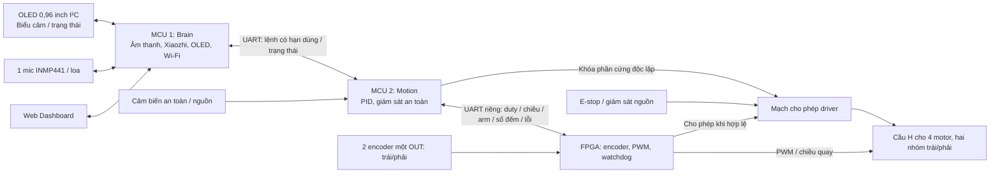

# AW-Car

Xe robot 4 bánh dùng ESP32-S3, hướng tới điều khiển qua Web Dashboard
và tương tác giọng nói Xiaozhi. Định hướng nguồn âm thanh là tính năng nâng cấp.

Tác giả: **TuanDanny**. Cộng tác viên: **Minh Nho** và **Nhan Duc**.

## Trạng thái

Schematic/PCB phát triển riêng trên **`feat/f04-pcb-schematic`**.
Target Tang Nano9K/Gowin tiếp tục trên
[`feat/f01-tang-nano9k-target`](https://github.com/TuanDanny/AW-Car/tree/feat/f01-tang-nano9k-target).

Ngày07/11/2026 có [schematic đấu nối chung một trang KiCad](hardware/pcb/README.md),
khổ A3,60 phần tử/68 net, module cắm rút. Có tụ nguồn, tụ sát motor và
jumper nguồn RUN/DEBUG. Bench ngspice chỉ kiểm tầng STBY ứng viên; nguồn
USB/DSN thực, gate đầy đủ và footprint còn mở, chưa phát hành PCB.

[Xem ảnh schematic A3](docs/awcar-schematic-a3.png) ·
[Phóng to SVG](docs/awcar-schematic-a3.svg) ·
[Mở thư mục KiCad](hardware/pcb/README.md).

Top FPGA triển khai là **[`aw_car_top`](fpga/rtl/aw_car_top.sv)**, bọc lõi
`drive_core`; chẩn đoán khi chạy đi qua STATUS v2 (RX/lệnh/mất mẫu/encoder/invariant),
không xuất bus debug thành chân board. Cấu hình tổng hợp ở [`synth_aw_car.ys`](fpga/synth_aw_car.ys).

Giai đoạn2 ngày05/11: [target Tang Nano9K/Gowin](fpga/targets/tang_nano9k/README.md)
có physical shell POR, pinout17 tín hiệu chức năng +6 LED onboard, CST/SDC, project/CLI và báo cáo STA.
Bài LED và AW-Car trước observer đã nạp SRAM bằng CLI trên board thật;
đã bổ sung và nạp LED trạng thái, người dùng xác nhận6 LED sáng; board hiện
chưa có gate. Xem [báo cáo LED](fpga/targets/tang_nano9k/status-leds-report.md).
Ngày06/11 đã lưu vào embedded Flash và kiểm tra xóa SRAM/reload không gửi
bitstream, đúng UserCode0x9EF7. Reset Brain/Motion và mất STATUS FPGA giữ
permit/duty0. [Báo cáo Flash/liên kết](fpga/targets/tang_nano9k/flash-link-report.md)
ghi power-cycle thật đã khởi động đúng AW-Car; ngắt UART có phát hiện và phục
hồi trong LOCKED. Bản sửa Motion4af21b8 đã nạp,62.072 frame/620,725s không
lỗi parser/HW/queue; reset từng board phục hồi, không tự ARM. Verify đọc lại
lịch sử vẫn FAIL; workflow nạp mới ghi rõ không yêu cầu byte verify. Xem
[bằng chứng sửa UART](docs/fpga-uart-repair-evidence.json) và
[kiểm tra Programmer](docs/fpga-programmer-workflow-evidence.json).
Gate/E-stop chưa có, chưa nghiệm thu truyền động.
Brain–Motion LOCKED đã chốt tại
[main4cea85c](https://github.com/TuanDanny/AW-Car/tree/v0.1-brain-motion-locked);
nhánh FPGA vẫn độc lập, không dùng RTL v1 baseline của main cho Motion v2.

Đồng bộ ngày **02/11/2026**: phần FPGA và encoder một OUT được gom vào
`feat/f01-fpga-drive`. Bản mặc định dùng **protocol v2: STATUS 34 byte payload,
47 byte frame**, có count/period/age; giữ lùi/quay tại chỗ, coast đổi chiều
40 ms, adapter DRV8833 và hạn phục hồi FAULT. V1 giữ để hồi quy; xem
[đặc tả v2](firmware/shared/fpga-protocol-v2.md). AI tiếp tục trên nhánh riêng.

Dự án đang chọn linh kiện, chưa lắp xe thử nghiệm. Kho hiện có khung thư mục,
tài liệu, quy tắc làm việc, RTL encoder/snapshot/PWM/UART/giao thức/FSM/watchdog/top,
adapter DRV8833 và mô phỏng;
chưa có bản xe tích hợp được nghiệm thu. Firmware Motion nằm trong main LOCKED;
checkout FPGA chỉ đồng bộ contract cần thiết. Cách chạy RTL
ở [fpga](fpga/README.md). Source Xiaozhi và demo AI điều khiển RGB đã thử được
ghi trong lịch sử nhánh AI; main hiện dùng WS2812 chỉ báo trạng thái và đã xóa demo RGB.
Toàn bộ mã HDL dùng SystemVerilog (`.sv`); hook và CI kiểm tra quy ước này.

- Yêu cầu ban đầu: [issue #1](https://github.com/TuanDanny/AW-Car/issues/1).
- [Kiểm tra binary Xiaozhi](docs/xiaozhi-binary-review.md): máy có binary gốc
  Xiaozhi 2.5.2 cho S3/ESP32; bản S3 khớp từng byte với release chính thức,
  đã tải source đúng commit để nghiên cứu. Người dùng đã thử hiển thị OLED,
  chưa tích hợp AW-Car.
- [Linh kiện đã có và mua từng bước](hardware/components.md): cập nhật 28/10/2026,
  thay BOM cũ làm mốc kiểm kê; OLED 0,96 inch **I²C**, MPU6050 và 2 ESP32-S3 có Wi-Fi.
- Sơ đồ tham chiếu ngày 24/10 (còn ghi TFT, chưa cập nhật kiểm kê mới):
  [ảnh phân công ESP32–FPGA](docs/aw-car-processor-map.png) và
  [luồng lệnh/phản hồi/an toàn](docs/aw-car-control-flow.png).
- Tổng quan phân cấp ngày 24/10 (tham chiếu lịch sử): [ảnh tổng quan](docs/aw-car-overview.png).
- [Rà soát kỹ thuật và kế hoạch hiệu chỉnh](docs/issue-1-technical-review.md):
  các điểm cần sửa trước khi mua linh kiện, kiến trúc đề xuất và tiêu chí nghiệm thu;
  ghi chú F01 về giữ tốc độ, kích đề-pa, quãng đường và mã Gray.

Cấu hình bản đầu: **2 ESP32-S3, 1 FPGA và 1 mic INMP441**, khung TT 4WD,
lái bằng tốc độ hai bên, không servo. FPGA đọc encoder và phát PWM cho hai
nhóm motor; Motion tính PID theo bên và giám sát an toàn. RTL mặc định đọc
encoder một OUT mỗi bên, hỗ trợ tiến/lùi/rẽ/quay tại chỗ; A/B là tùy chọn.
Số đếm một OUT không cho biết chiều quay thực. Board mục tiêu là **Tang Nano 9K**
(`GW1NR-LV9QN88PC6/I5`), đã có và chạy bài LED. Target mới có Gowin PnR/STA,
nhưng chưa thay kiểm thử AW-Car trên board và gate an toàn độc lập.
Xem [kế hoạch FPGA và toàn hệ thống](docs/fpga-drive-plan.md) và
[hợp đồng ARM/gate](firmware/shared/fpga-safety.md).

Mic phục vụ thu giọng nói/lệnh; DoA và tự hướng về người nói được giữ cho nâng
cấp bằng cụm mic thu đồng bộ. Đồ án hiện hướng tới 3 môn: Tích hợp hệ thống cảm
biến, Lý thuyết mạch và RTL/FPGA; đã bỏ mục tiêu môn PCB khuếch đại.

## Cấu trúc thư mục

| Thư mục | Nội dung |
| --- | --- |
| [firmware/brain](firmware/brain/README.md) | MCU 1: âm thanh, Xiaozhi, OLED I²C, mạng |
| [firmware/motion](firmware/motion/README.md) | MCU 2: truyền động, PID, an toàn |
| [firmware/shared](firmware/shared/README.md) | Giao thức và kiểu dữ liệu chung |
| [fpga](fpga/README.md) | RTL encoder, PWM hai bên motor và watchdog |
| [dashboard](dashboard/README.md) | Giao diện điều khiển và telemetry |
| [hardware](hardware/README.md) | BOM, nguồn, cơ khí, sơ đồ và PCB |
| [docs](docs/README.md) | Yêu cầu, quyết định và kế hoạch thử nghiệm |
| [tests](tests/README.md) | Kiểm thử tự động |
| [tools](tools/README.md) | Công cụ kiểm tra và phát triển |

Mỗi thư mục có README giới thiệu. [AGENTS.md](AGENTS.md) là quy tắc dành cho agent.

## Làm việc và kiểm tra

Hai nhánh làm việc hiện tại: **`feat/f01-fpga-drive`** cho FPGA/truyền động và
**`feat/f03-xiaozhi-ai`** cho AI. Dùng task/commit để theo dõi từng bước nhỏ;
PR vào main và **squash merge** sau khi kiểm tra/review đạt.
Xem [quy trình Git](docs/workflow.md).

```sh
git config --local core.hooksPath .githooks
python tools/check_repo.py
python -m unittest discover -s tests
git diff --check
```

Hooks áp dụng cho clone đã bật; CI và ruleset GitHub có vai trò riêng. Bản setup
hiện chưa bật bảo vệ main trên GitHub. Kiểm tra cấu trúc không thay thế build
firmware hoặc phép đo trên xe.

## Kiến trúc đã chốt về phân tải



MCU Motion có quyền từ chối lệnh và dừng xe độc lập khi MCU Brain, mạng hoặc AI
gặp lỗi. FPGA tự hết hạn lệnh Motion; Motion khóa driver nếu FPGA mất phản hồi.
Mạch khóa driver phải giữ motor tắt cả khi FPGA chưa cấu hình hoặc mất nguồn.
Firmware MCU dự kiến dùng ESP-IDF/FreeRTOS. Controller OLED và khả năng dùng
LVGL/GIF/QR chờ xác minh màn hình; không giữ mặc định yêu cầu TFT cũ.

## Thứ tự thực hiện

1. Đối chiếu đồ đã có; chọn lần lượt encoder/gá cho bộ TT 4WD, driver,
   nguồn và chế độ dừng theo [kế hoạch mua](hardware/components.md).
2. Viết RTL độc lập hãng và testbench; mô phỏng cả lỗi và mất/reset từng khối.
3. Không cần Quartus: mô phỏng bằng Icarus/VVP, tổng hợp, place-and-route và
   kiểm tra timing bằng Gowin Education cho đúng chip Tang Nano ứng viên.
   Chọn board theo tài nguyên/I/O/nguồn và ngân sách; xem
   [kế hoạch thiết kế RTL và kiểm thử](docs/fpga-rtl-design-test-plan.md).
4. Mua sau khi đủ bằng chứng thiết kế; thử FPGA + Motion + driver trên bàn,
   sau đó tích hợp cảm biến/PID, UART Brain và Dashboard ở tốc độ thấp.
5. Tích hợp OLED I²C và Xiaozhi; cảnh báo thiết yếu phải phát được khi mất Internet.
6. Thiết kế motherboard 2 MCU/1 FPGA/1 mic sau khi nguyên mẫu đạt nghiệm thu.
7. Nâng cấp DoA: chọn cụm mic, chứng minh thu đồng bộ, rồi thử định hướng/di
   chuyển theo âm; có thể cần sửa phần cứng và PCB.

Danh sách F01-F06, các giới hạn và điều kiện chuyển giai đoạn nằm trong
[bản rà soát](docs/issue-1-technical-review.md).
