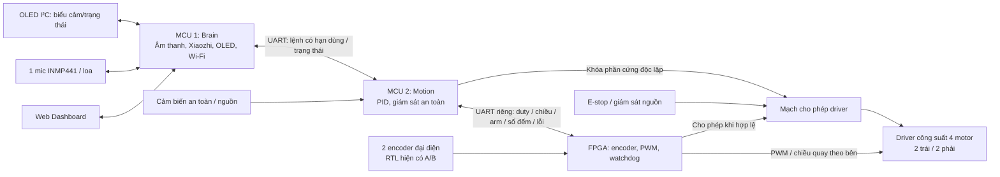

# AW-Car

Xe robot 4 bánh dùng ESP32-S3, hướng tới điều khiển qua Web Dashboard
và tương tác giọng nói Xiaozhi. Định hướng nguồn âm thanh là tính năng nâng cấp.

Tác giả: **TuanDanny**. Cộng tác viên: **Minh Nho** và **Nhan Duc**.

## Trạng thái

Dự án đang chọn linh kiện, chưa lắp xe thử nghiệm. Kho hiện có khung thư mục,
tài liệu, quy tắc làm việc, RTL encoder/snapshot/PWM/UART/giao thức/FSM/watchdog/top và mô phỏng;
đã có source nền Xiaozhi v2.5.2 tại [firmware/brain](firmware/brain/README.md)
trên nhánh F03, chưa có firmware AW-Car tích hợp, sơ đồ điện hay PCB.
Chủ dự án đã nạp binary stock và xác nhận OLED hiển thị với GPIO 41/42;
source nhập vào repo chưa build/nạp lại. Cách chạy RTL ở [fpga](fpga/README.md).
Toàn bộ mã HDL dùng SystemVerilog (`.sv`); hook và CI kiểm tra quy ước này.

- Yêu cầu ban đầu: [issue #1](https://github.com/TuanDanny/AW-Car/issues/1).
- [Phát triển AI/Xiaozhi F03](firmware/brain/README.md): nhánh
  `feat/f03-xiaozhi-ai`, source upstream đã chốt commit, cấu hình và lộ trình
  kiểm chứng trước tích hợp UART Brain–Motion.
- [Rà soát kỹ thuật và kế hoạch hiệu chỉnh](docs/issue-1-technical-review.md):
  các điểm cần sửa trước khi mua linh kiện, kiến trúc đề xuất và tiêu chí nghiệm thu.

Cấu hình đã chốt ngày 23/10/2026: **2 ESP32-S3, 1 FPGA và 1 mic INMP441**.
Quyết định ngày 28/10: giữ khung TT 4WD, lái bằng tốc độ hai bên, không dùng
servo. FPGA hiện đọc hai encoder A/B và phát PWM cho hai nhóm motor;
mode encoder một OUT mới là kế hoạch. Motion tính PID theo bên và giám sát
an toàn. Tài liệu cơ khí/phần cứng đang được cập nhật trên nhánh riêng.
Board mục tiêu là **Tang Nano 9K**
(`GW1NR-LV9QN88PC6/I5`), chưa mua. Tối ưu RTL vẫn giữ mục tiêu 9K;
mô phỏng và tổng hợp sơ bộ chưa thay kết quả fit/timing trên đúng chip.
Xem [kế hoạch FPGA và toàn hệ thống](docs/fpga-drive-plan.md) và
[hợp đồng ARM/gate](firmware/shared/fpga-safety.md).

Mic phục vụ thu giọng nói/lệnh; DoA và tự hướng về người nói được giữ cho nâng
cấp bằng cụm mic thu đồng bộ. Đồ án hiện hướng tới 3 môn: Tích hợp hệ thống cảm
biến, Lý thuyết mạch và RTL/FPGA; đã bỏ mục tiêu môn PCB khuếch đại.

## Cấu trúc thư mục

| Thư mục | Nội dung |
| --- | --- |
| [firmware/brain](firmware/brain/README.md) | MCU 1: source Xiaozhi, âm thanh, OLED I²C, mạng |
| [firmware/motion](firmware/motion/README.md) | MCU 2: truyền động, PID, an toàn |
| [firmware/shared](firmware/shared/README.md) | Giao thức và kiểu dữ liệu chung |
| [fpga](fpga/README.md) | RTL encoder, PWM 2 motor và watchdog |
| [dashboard](dashboard/README.md) | Giao diện điều khiển và telemetry |
| [hardware](hardware/README.md) | BOM, nguồn, cơ khí, sơ đồ và PCB |
| [docs](docs/README.md) | Yêu cầu, quyết định và kế hoạch thử nghiệm |
| [tests](tests/README.md) | Kiểm thử tự động |
| [tools](tools/README.md) | Công cụ kiểm tra và phát triển |

Mỗi thư mục có README giới thiệu. [AGENTS.md](AGENTS.md) là quy tắc dành cho agent.

## Làm việc và kiểm tra

Mỗi tính năng một nhánh `feat/fXX-ten-ngan`, PR vào main và **squash merge** sau
khi kiểm tra/review đạt. Xem [quy trình Git](docs/workflow.md).

```sh
git config --local core.hooksPath .githooks
python tools/check_repo.py
python -m unittest discover -s tests
git diff --check
```

Hooks áp dụng cho clone đã bật; CI và ruleset GitHub có vai trò riêng. Bản setup
hiện chưa bật bảo vệ main trên GitHub. Kiểm tra cấu trúc không thay thế build
firmware hoặc phép đo trên xe.

## Kiến trúc đã chốt về phân tải



MCU Motion có quyền từ chối lệnh và dừng xe độc lập khi MCU Brain, mạng hoặc AI
gặp lỗi. FPGA tự hết hạn lệnh Motion; Motion khóa driver nếu FPGA mất phản hồi.
Mạch khóa driver phải giữ motor tắt cả khi FPGA chưa cấu hình hoặc mất nguồn.
LVGL là thư viện giao diện; firmware MCU dự kiến dùng ESP-IDF/FreeRTOS.

## Thứ tự thực hiện

1. Đặc tả RTL/giao tiếp và nguồn, motor/encoder, hình học lái, chế độ dừng.
2. Viết RTL độc lập hãng và testbench; mô phỏng cả lỗi và mất/reset từng khối.
3. Không cần Quartus: mô phỏng bằng Icarus/VVP, tổng hợp, place-and-route và
   kiểm tra timing bằng Gowin Education cho đúng chip Tang Nano ứng viên.
   Chọn board theo tài nguyên/I/O/nguồn và ngân sách; xem
   [kế hoạch thiết kế RTL và kiểm thử](docs/fpga-rtl-design-test-plan.md).
4. Mua sau khi đủ bằng chứng thiết kế; thử FPGA + Motion + driver trên bàn,
   sau đó tích hợp cảm biến/PID, UART Brain và Dashboard ở tốc độ thấp.
5. Tích hợp OLED I²C và Xiaozhi; cảnh báo thiết yếu phải phát được khi mất Internet.
6. Thiết kế motherboard 2 MCU/1 FPGA/1 mic sau khi nguyên mẫu đạt nghiệm thu.
7. Nâng cấp DoA: chọn cụm mic, chứng minh thu đồng bộ, rồi thử định hướng/di
   chuyển theo âm; có thể cần sửa phần cứng và PCB.

Danh sách F01-F06, các giới hạn và điều kiện chuyển giai đoạn nằm trong
[bản rà soát](docs/issue-1-technical-review.md).
