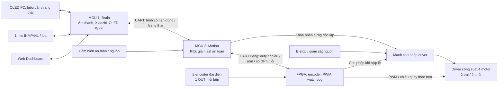

# AW-Car

Xe robot 4 bánh dùng ESP32-S3, hướng tới điều khiển qua Web Dashboard
và tương tác giọng nói Xiaozhi. Định hướng nguồn âm thanh là tính năng nâng cấp.

Tác giả: **TuanDanny**. Cộng tác viên: **Minh Nho** và **Nhan Duc**.

## Trạng thái

Mốc04/11/2026: bổ sung reconnect AP+STA có backoff, chẩn đoán HTTP/WS và
dashboard tối giản. Đã build/kiểm thử host và đọc monitor COM3 Brain/COM7
Motion thật. Đã nạp giao diện mới; thử một chiều Motion→Brain đạt20Hz,
0lỗi/age10–13ms. Đã đổi Motion sang TX13/RX14 để bỏ17/18 bị thông trở
thấp và nạp hai board. UART hai chiều đạt0lỗi; Android WS giữ189s qua3lần
retry STA, không đóng. Đã nối STA Internet đồng thời AW-CAR: nhận IP,
Xiaozhi có3lượt nhận dạng/4đoạn trả lời, không ngắt WS hoặc lỗi UART trong
cửa sổ đo. **Chưa nghiệm thu motor/loa**. Scan có client AP~1,65s thay2,83s.
Xem [báo cáo mạng, UI và phần cứng](docs/brain-network-reliability.md).

Mốc 03/11/2026 trên nhánh AI: đã có source dashboard Manual/AI, AP+STA,
lõi Brain độc lập RTOS, UART BM-v1 và Motion PC test peer. Firmware đã build;
kiểm thử host theo [hướng dẫn dashboard](dashboard/README.md) và
[thiết kế Brain](firmware/brain/docs/dashboard-brain.md). Đã nạp bản mới qua
COM3 tại 0x0000, giữ NVS; boot/PSRAM/OLED/audio init, AP+STA và WPA2 beacon
đã kiểm tra. Đã sửa lỗi WS sau đăng nhập; người dùng xác nhận Safari ổn định,
RGB và nút nghe trên Web hoạt động. **Chưa nghiệm thu UART Brain–Motion,
loa, mọi tình huống metadata AI hoặc motor**.
Xem [bằng chứng kiểm thử Brain/dashboard](docs/brain-dashboard-verification.md).
Các kết quả 29/10 bên dưới là baseline phần cứng, không thay nghiệm thu bản mới.

Dự án đang chọn linh kiện, chưa lắp xe thử nghiệm. Kho hiện có khung thư mục,
tài liệu, quy tắc làm việc, RTL encoder/snapshot/PWM/UART/giao thức/FSM/watchdog/top và mô phỏng;
đã có source nền Xiaozhi v2.5.2 tại [firmware/brain](firmware/brain/README.md)
trên nhánh F03 và bản tích hợp Brain/dashboard để thử với Motion giả lập;
chưa có firmware Motion hoàn chỉnh, sơ đồ điện hay PCB.
Ngày 29/10/2026 đã build source bằng ESP-IDF 6.1, nạp tại 0x0000 và xác nhận
boot/PSRAM/OLED/audio init/Wi-Fi qua log; chủ dự án xác nhận OLED 41/42 hiển
thị mã kích hoạt và báo đã hoàn tất thao tác. Sau khi gắn INMP441, đã thu
được văn bản nhận dạng và AI trả lời qua log; chủ dự án xác nhận OLED hiện
câu nói bằng tiếng Trung và chọn giữ ngôn ngữ này. Loa chưa gắn, chưa thử
âm thanh trả lời. Profile AW-Car RGB có lệnh bật/tắt/đổi màu bằng tiếng
Trung, giữ màu qua trạng thái hội thoại. Đã thử đủ bật/tắt và ba màu đỏ,
xanh lá, xanh dương: log callback khớp và chủ dự án xác nhận LED thực đổi màu.
Xem [kết quả demo F03](firmware/brain/docs/ai-rgb-demo.md).
Chưa tích hợp điều khiển xe. Cách chạy RTL
ở [fpga](fpga/README.md).
Toàn bộ mã HDL dùng SystemVerilog (`.sv`); hook và CI kiểm tra quy ước này.

- Yêu cầu ban đầu: [issue #1](https://github.com/TuanDanny/AW-Car/issues/1).
- [Phát triển AI/Xiaozhi F03](firmware/brain/README.md): nhánh
  `feat/f03-xiaozhi-ai`, source upstream đã chốt commit, cấu hình và lộ trình
  kiểm chứng trước tích hợp UART Brain–Motion.
- [Rà soát kỹ thuật và kế hoạch hiệu chỉnh](docs/issue-1-technical-review.md):
  các điểm cần sửa trước khi mua linh kiện, kiến trúc đề xuất và tiêu chí nghiệm thu;
  ghi chú F01 về giữ tốc độ, kích đề-pa, quãng đường và mã Gray.

Cấu hình bản đầu: **2 ESP32-S3, 1 FPGA và 1 mic INMP441**, khung TT 4WD,
lái bằng tốc độ hai bên, không servo. FPGA đọc encoder và phát PWM cho hai
nhóm motor; Motion tính PID theo bên và giám sát an toàn. Nhánh FPGA hiện
dùng một OUT mỗi bên và protocol v2; checkout AI giữ lịch sử RTL riêng,
không dùng nó để kết luận trạng thái FPGA mới nhất. Board mục tiêu là **Tang Nano 9K**
(`GW1NR-LV9QN88PC6/I5`), chưa mua. Tối ưu RTL vẫn giữ mục tiêu 9K;
mô phỏng và tổng hợp sơ bộ chưa thay kết quả fit/timing trên đúng chip.
Xem [kế hoạch FPGA và toàn hệ thống](docs/fpga-drive-plan.md) và
[hợp đồng ARM/gate](firmware/shared/fpga-safety.md).

Mic phục vụ thu giọng nói/lệnh; DoA và tự hướng về người nói được giữ cho nâng
cấp bằng cụm mic thu đồng bộ. Đồ án hiện hướng tới 3 môn: Tích hợp hệ thống cảm
biến, Lý thuyết mạch và RTL/FPGA; đã bỏ mục tiêu môn PCB khuếch đại.

## Cấu trúc thư mục

| Thư mục | Nội dung |
| --- | --- |
| [firmware/brain](firmware/brain/README.md) | MCU 1: source Xiaozhi, âm thanh, OLED I²C, mạng |
| [firmware/motion](firmware/motion/README.md) | MCU 2: truyền động, PID, an toàn |
| [firmware/shared](firmware/shared/README.md) | Giao thức và kiểu dữ liệu chung |
| [fpga](fpga/README.md) | RTL encoder, PWM 2 motor và watchdog |
| [dashboard](dashboard/README.md) | Web Manual/AI, RGB, transcript, telemetry và simulator |
| [hardware](hardware/README.md) | BOM, nguồn, cơ khí, sơ đồ và PCB |
| [docs](docs/README.md) | Yêu cầu, quyết định và kế hoạch thử nghiệm |
| [tests](tests/README.md) | Kiểm thử tự động |
| [tools](tools/README.md) | Công cụ kiểm tra và phát triển |

Mỗi thư mục có README giới thiệu. [AGENTS.md](AGENTS.md) là quy tắc dành cho agent.

## Làm việc và kiểm tra

Ba nhánh theo quyết định03/11: **`feat/f01-fpga-drive`** cho FPGA,
**`feat/f03-xiaozhi-ai`** cho AI và **`codex/esp32-s3-motion`** cho Motion. Dùng task/commit để theo dõi từng bước nhỏ;
PR vào main và **squash merge** sau khi kiểm tra/review đạt.
Xem [quy trình Git](docs/workflow.md).

```sh
git config --local core.hooksPath .githooks
python tools/check_repo.py
python -m unittest discover -s tests
git diff --check
```

Hooks áp dụng cho clone đã bật; CI và ruleset GitHub có vai trò riêng. Bản setup
hiện chưa bật bảo vệ main trên GitHub. Kiểm tra cấu trúc không thay thế build
firmware hoặc phép đo trên xe.

## Kiến trúc đã chốt về phân tải



MCU Motion có quyền từ chối lệnh và dừng xe độc lập khi MCU Brain, mạng hoặc AI
gặp lỗi. FPGA tự hết hạn lệnh Motion; Motion khóa driver nếu FPGA mất phản hồi.
Mạch khóa driver phải giữ motor tắt cả khi FPGA chưa cấu hình hoặc mất nguồn.
LVGL là thư viện giao diện; firmware MCU dự kiến dùng ESP-IDF/FreeRTOS.

## Thứ tự thực hiện

1. Đặc tả RTL/giao tiếp và nguồn, motor/encoder, hình học lái, chế độ dừng.
2. Viết RTL độc lập hãng và testbench; mô phỏng cả lỗi và mất/reset từng khối.
3. Không cần Quartus: mô phỏng bằng Icarus/VVP, tổng hợp, place-and-route và
   kiểm tra timing bằng Gowin Education cho đúng chip Tang Nano ứng viên.
   Chọn board theo tài nguyên/I/O/nguồn và ngân sách; xem
   [kế hoạch thiết kế RTL và kiểm thử](docs/fpga-rtl-design-test-plan.md).
4. Mua sau khi đủ bằng chứng thiết kế; thử FPGA + Motion + driver trên bàn,
   sau đó tích hợp cảm biến/PID, UART Brain và Dashboard ở tốc độ thấp.
5. Tích hợp OLED I²C và Xiaozhi; cảnh báo thiết yếu phải phát được khi mất Internet.
6. Thiết kế motherboard 2 MCU/1 FPGA/1 mic sau khi nguyên mẫu đạt nghiệm thu.
7. Nâng cấp DoA: chọn cụm mic, chứng minh thu đồng bộ, rồi thử định hướng/di
   chuyển theo âm; có thể cần sửa phần cứng và PCB.

Danh sách F01-F06, các giới hạn và điều kiện chuyển giai đoạn nằm trong
[bản rà soát](docs/issue-1-technical-review.md).
