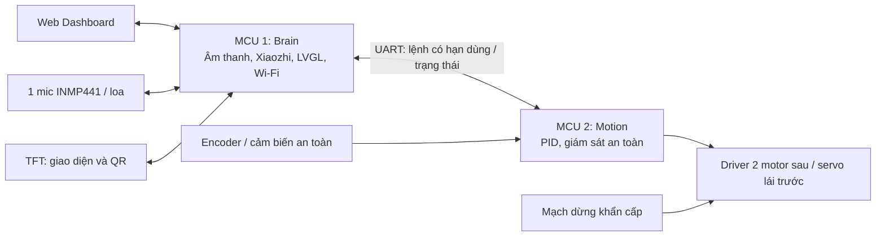

# AW-Car

Xe robot 4 bánh dùng ESP32-S3, hướng tới điều khiển qua Web Dashboard
và tương tác giọng nói Xiaozhi. Định hướng nguồn âm thanh là tính năng nâng cấp.

Tác giả: **TuanDanny**. Cộng tác viên: **Minh Nho** và **Nhan Duc**.

## Trạng thái

Dự án đang chọn linh kiện, chưa lắp xe thử nghiệm. Kho hiện có khung thư mục,
tài liệu, quy tắc làm việc và kiểm tra cấu trúc; chưa có firmware, sơ đồ điện
hay PCB. Chưa có tính năng nào được xác nhận hoạt động trên phần cứng.

- Yêu cầu ban đầu: [issue #1](https://github.com/TuanDanny/AW-Car/issues/1).
- [Rà soát kỹ thuật và kế hoạch hiệu chỉnh](docs/issue-1-technical-review.md):
  các điểm cần sửa trước khi mua linh kiện, kiến trúc đề xuất và tiêu chí nghiệm thu.

Cấu hình bản đầu đã xác nhận sau cập nhật issue ngày 23/10/2026: **2 ESP32-S3
và 1 mic INMP441**. Mic phục vụ thu giọng nói/lệnh; DoA và tự hướng về người nói
được giữ cho giai đoạn nâng cấp bằng cụm mic thu đồng bộ.

## Cấu trúc thư mục

| Thư mục | Nội dung |
| --- | --- |
| [firmware/brain](firmware/brain/README.md) | MCU 1: âm thanh, Xiaozhi, TFT, mạng |
| [firmware/motion](firmware/motion/README.md) | MCU 2: truyền động, PID, an toàn |
| [firmware/shared](firmware/shared/README.md) | Giao thức và kiểu dữ liệu chung |
| [dashboard](dashboard/README.md) | Giao diện điều khiển và telemetry |
| [hardware](hardware/README.md) | BOM, nguồn, cơ khí, sơ đồ và PCB |
| [docs](docs/README.md) | Yêu cầu, quyết định và kế hoạch thử nghiệm |
| [tests](tests/README.md) | Kiểm thử tự động |
| [tools](tools/README.md) | Công cụ kiểm tra và phát triển |

Mỗi thư mục có README giới thiệu. [AGENTS.md](AGENTS.md) là quy tắc dành cho agent.

## Làm việc và kiểm tra

Mỗi tính năng một nhánh `feat/fXX-ten-ngan`, PR vào main và **squash merge** sau
khi kiểm tra/review đạt. Xem [quy trình Git](docs/workflow.md).

```sh
git config --local core.hooksPath .githooks
python tools/check_repo.py
python -m unittest discover -s tests
git diff --check
```

Hooks áp dụng cho clone đã bật; CI và ruleset GitHub có vai trò riêng. Bản setup
hiện chưa bật bảo vệ main trên GitHub. Kiểm tra cấu trúc không thay thế build
firmware hoặc phép đo trên xe.

## Kiến trúc đề xuất



MCU Motion có quyền từ chối lệnh và dừng xe độc lập khi MCU Brain, mạng hoặc AI
gặp lỗi. LVGL là thư viện giao diện; nền tảng chạy firmware dự kiến là
ESP-IDF/FreeRTOS. Cấu hình bản đầu dùng 2 MCU; chỉ cân nhắc thêm sau khi đo tải.

## Thứ tự thực hiện

1. Chốt hình học xe, motor/encoder, dòng kẹt và hệ thống nguồn.
2. Chạy thử Motion: dừng an toàn, encoder, PID và cảm biến.
3. Thêm UART và Web Dashboard với cơ chế hết hạn lệnh.
4. Thêm TFT/LVGL và Xiaozhi; cảnh báo thiết yếu phải phát được khi mất Internet.
5. Thiết kế motherboard bản đầu sau khi nguyên mẫu 1 mic vượt các bài nghiệm thu.
6. Nâng cấp DoA: chọn cụm mic, chứng minh thu đồng bộ, rồi thử định hướng/di
   chuyển theo âm; có thể cần sửa phần cứng và PCB.

Danh sách F01-F06, các giới hạn và điều kiện chuyển giai đoạn nằm trong
[bản rà soát](docs/issue-1-technical-review.md).
