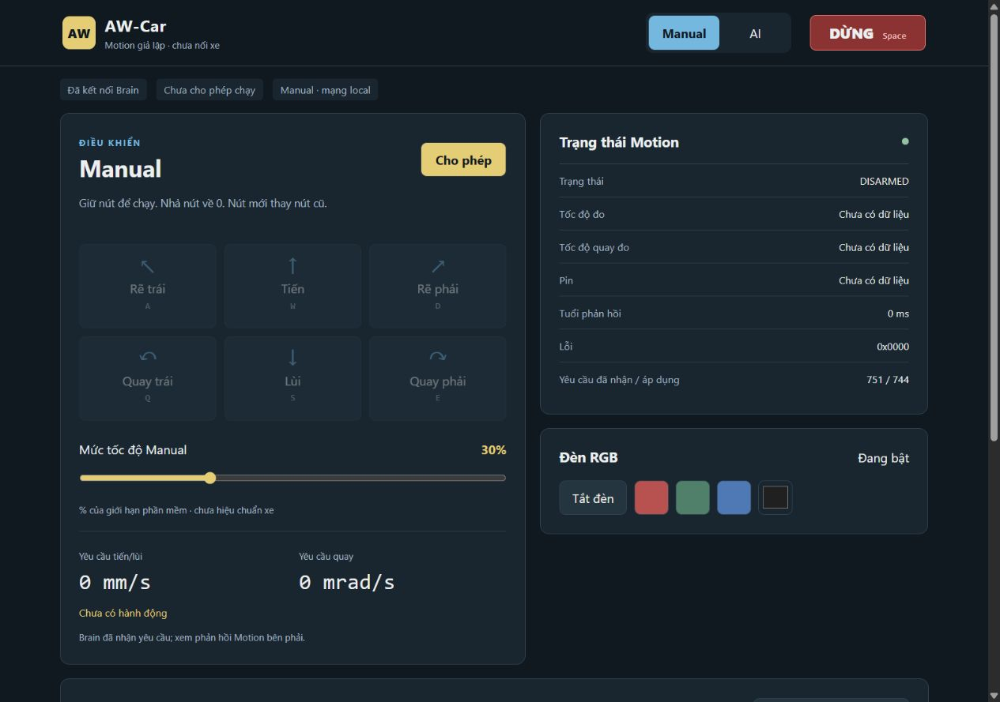
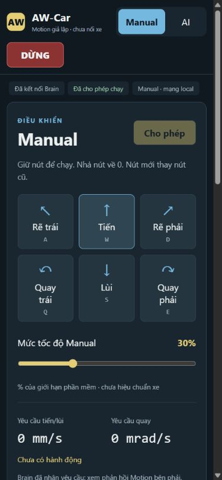

# Brain/dashboard — bằng chứng ngày 03/11/2026

Nhánh `feat/f03-xiaozhi-ai`, phát triển từ baseline `112914e`. Mốc này kiểm
chứng Brain/dashboard với PC Motion test peer. Không có firmware Motion/PID,
FPGA hoặc motor thật trong vòng kiểm thử. Mốc giả lập không nạp ESP32;
sau đó người dùng yêu cầu nạp board, kết quả bổ sung ở cuối tài liệu.

## Mã và môi trường

- Firmware ESP-IDF 6.1 / ESP32-S3, profile `aw-car-ai-rgb-128x64`, tiếng Trung.
- Host Windows, Python 3.13, aiohttp 3.13.2, LLVM-MinGW clang C++17/O2.
- Host nạp chính `control_core.cc`, `voice_gate.h` và codec BM-v1 dùng cho
  firmware; Python độc lập đóng vai Motion, không mô phỏng PWM/PID/cơ khí.
- Lõi được đo có digest `114a69dcd53a`; manifest nguồn/compiler/binary ở
  `build/brain/brain-114a69dcd53a.manifest.json`. Giới hạn 200 mm/s và
  1000 mrad/s là cấu hình LAB, chưa hiệu chuẩn xe.

## Kiểm tra chức năng

| Nhóm | Bằng chứng | Kết quả |
| --- | --- | --- |
| Boot, HELLO/ARM/STOP, neutral | `tests/test_brain_core.py` | Đạt, phải có ACK Motion đúng phiên/yêu cầu |
| Sáu hướng, 0/30/100%, thay lệnh | C++ tests và `dashboard/control.test.mjs` | Đạt; neutral giữ ARM, STOP bỏ ARM |
| Manual TTL/deadman | Clock chủ động ở 119999/120000 và 149999/150000 µs | Đạt; lệnh lỗi không gia hạn |
| AI 1 giây, giới hạn 3 giây, quyền 5 phút | Clock chủ động, lệnh mới thay cũ | Đạt; không tự gia hạn quyền |
| Epoch, challenge, sequence wrap, callback cũ | C++/VoiceGate tests | Đạt; thiếu SID/STT hoặc callback muộn bị từ chối |
| Motion reset / STATUS lặp, sai phiên, CRC | C++ và serial peer tests | Đạt; phục hồi phải ARM mới, không phát lại mục tiêu |
| HTTP/JSON/auth/Origin/một WS | `tests/test_brain_web.py` | Đạt; sai kiểu số không được coi là lệnh hợp lệ |
| Internet/mất Web theo mode | C++/HTTP và computer use | Đạt trong giả lập |
| RGB, transcript, không có telemetry | HTTP + browser | Đạt; số đo chưa có là null/“Chưa có dữ liệu” |
| Repository và quy tắc | `python tools/check_repo.py`, unittest, diff check | Đạt |

Full host regression cuối gồm **72 ca Python và 3 ca Node, đều đạt**.
Có 10.000 thao tác ngẫu nhiên kiểm bất biến không quyền → mục tiêu 0.
Không dùng thời gian thực Windows làm clock cho kiểm tra biên chức năng;
bài soak bên dưới đo thời gian thực.

[CI Linux của source 33023d7](https://github.com/TuanDanny/AW-Car/actions/runs/41603932025/job/125809002156)
đạt 71 ca Python, 3 ca Node và toàn bộ **110 ca upstream Xiaozhi**.
Ca thứ 72 bổ sung kiểm tra bộ lấy số đo RAM Win64 sau đó. Chạy 110 ca trên
Windows gặp 11 lỗi môi trường (dọn temporary cwd/runner bash), không gọi
lần chạy đó đạt; CI Linux là bằng chứng hồi quy upstream. CI repository
cũng đạt; RTL không bị sửa trong mốc này.

## Computer use

Thao tác qua trình duyệt thật, cùng asset phục vụ từ Brain:

- Desktop: đăng nhập, W/S/A/D/Q/E, pointer giữ/nhả, chuyển mode, Cho phép,
  ba màu RGB, transcript Trung và tool giả lập; kết thúc hành động về 0.
- Điện thoại 390×844: không tràn ngang, DỪNG nằm trong header cố định;
  Manual vẫn dùng được khi Internet giả lập bị ngắt.
- AI vẫn giữ thời hạn khi Web refresh; hết 5 phút tự DISARMED.
- Trang thứ hai bị từ chối; AI mất Internet thu quyền và về DISARMED.
- Manual mất STATUS: nút lái khóa, target 0, không gọi dữ liệu cũ là số đo mới.

Ảnh/log cục bộ: `build/brain/cua/desktop-ai.png`, `mobile-ai.png`,
`mobile-manual.png`, `mobile-ai-offline.png`, `second-dashboard-rejected.png`
và `interaction-report.json`. Không commit cookie/PIN của fixture.
Pointer-cancel đi qua cùng đường release có kiểm tra logic; chưa tạo được
ngắt touch thực từ hệ điều hành/điện thoại trong computer use.

## Tải và độ trễ

Bài cuối dùng `tools/brain_soak.py --seconds 1800` qua WebSocket localhost,
20 lệnh/giây, cùng lõi C++. **Đạt:** 1800,242 giây thực, 36.000 MOVE,
36.002 ACK (gồm ARM/STOP), 36.000 mẫu UART; không reject, không mất quyền
ngoài dự kiến, không tua clock. Mỗi hướng và neutral có ít nhất 5.140 lệnh.
Raw JSON: `build/brain/soak-release.json`, SHA-256
`996ef0555c907e200cf7cc189550ef9a240d2b08119f00fe2cc3258c0e2dd6d3`.

| Chặng đo trên PC (ms) | p50 | p95 | p99 | max |
| --- | ---: | ---: | ---: | ---: |
| Handler JSON → mock nhận UART | 0,134 | 0,246 | 0,432 | 27,451 |
| WebSocket gửi → nhận ACK Brain | 0,828 | 3,386 | 13,043 | 60,283 |

Tối đa 2 request chờ ACK; hàng mục tiêu UART tối đa 1, trace 256/256,
buffer độ trễ 36.000/40.000. Client Python tracemalloc cuối 1.315.445 byte,
peak 1.400.185 byte. Đây không phải heap ESP32.

RAM server theo bộ đếm hệ điều hành: working set 45.178.880–46.305.280
byte trong 142 mẫu cuối khoảng 11 phút 47 giây; peak lifetime process
46.305.280 byte. File `build/brain/soak-memory.ndjson` ghi timestamp/PID.
Bộ lấy RAM nội bộ của lần soak trả 0 do ctypes cắt HANDLE Win64: các mẫu
đó **không hợp lệ**, đã sửa và thêm hồi quy. Không dùng 0 làm bằng chứng
không tốn RAM; dữ liệu OS thay thế chỉ bao phủ khoảng quan sát nêu trên.

Hai bài trước trên bản lõi cũ nhận một STALE đầu phiên vì challenge chưa
được đổi cùng epoch. Đã sửa và thêm hồi quy; không dùng hai bài đó để gọi
bản cuối đạt. Các buffer trace/latency/log đã giới hạn dung lượng.

Đo riêng handler JSON → mock nhận frame UART và RTT ACK WebSocket. Hai số
này **không** chứng minh p95/p99 FreeRTOS/Wi-Fi/UART chân TX, AI cloud hay
thời gian motor dừng. Firmware có cửa sổ 128 mẫu Web hợp lệ → gọi UART
driver, heap free/min và dư stack để đo tiếp trên board; hiện chưa có mẫu.

## Build và phần còn phải nghiệm thu

ESP-IDF 6.1 build AW-Car **và stock bread-compact-wifi đều đạt**. Image
AW-Car tương ứng source `33023d7`, chưa nạp. Các artifact cục bộ:

| Artifact | Byte | SHA-256 |
| --- | ---: | --- |
| `firmware/brain/build/merged-binary.bin`, offset 0x0000 | 8.949.619 | `8c431f97208a4a6372e6d07dc4bc12423b2abe8a1ed0e1e9d1d31ba5145814b1` |
| `firmware/brain/build/xiaozhi.bin` | 2.660.352 | `85a842b811c36dd8766cadab50684ec61fede9979739810f21bb67310e030282` |
| `firmware/brain/build/stock/xiaozhi.bin` | 2.583.840 | `922aa67b51847a329ef6b107c581b887f1d805f6debb4910588062c1fad36aac` |

Log `build/brain/firmware-build-release.log` và `firmware-build-stock.log`.
Binary, sdkconfig và log build được ignore. Build không ghi NVS; lần nạp
merged image sau này phải backup/giữ hoặc phục hồi NVS theo hướng dẫn,
vì các vùng trống trong merged image không tự bảo toàn dữ liệu đã lưu.

Chưa nghiệm thu: giao dịch HTTP/WS từ client AP, PIN OLED đọc thực,
mic/loa/RGB/BOOT sau tích hợp, UART vật lý 17/18, stack/heap/độ trễ ESP32,
metadata SID/STT thực của backend, Motion/FPGA/gate/motor. Thiếu metadata
thì tool move khóa; không bỏ guard để demo. Build/boot và giả lập không
thay các phép thử này.

## Bổ sung: nạp board theo yêu cầu người dùng

Ngày 03/11/2026 đã nạp board ESP32-S3 đang cắm tại COM3, offset **0x0000**:

- Đọc/sao lưu đủ 16 MB flash trước khi ghi. Bảng phân vùng thiết bị khớp
  image. Tạo bản merged cục bộ chỉ thay NVS 0x9000–0xCFFF bằng dữ liệu cũ.
- Esptool 5.6.0 xác minh hash sau ghi. Đọc lại 16 KB NVS khi còn ở bootloader
  khớp từng byte với bản trước ghi; app boot sau đó có thể lưu namespace mới.
- Theo dõi boot 60 giây: ELF khớp
  `ad405476290a1bed8abdc2f067ea5b654cf59ffb0c273e65463f5ef882b60768`,
  PSRAM 8 MB, SSD1306 41/42, simplex I²S/audio codec và RGB48 khởi tạo.
- Có đủ ba tool RGB và ba tool `self.car.*`; HTTP server bind interface AP.
  AP+STA hoạt động, STA nhận IP bằng cấu hình đã lưu; app về idle.
- DHCP AP dùng 192.168.4.1; PC quét thấy AP WPA2-Personal/CCMP. HTTP không
  đáp ứng trên IP STA trong phép thử, đúng thiết kế chỉ phục vụ interface AP.
- Không có panic/assert/abort/backtrace/stack overflow trong 60 giây đã ghi.

Backup/image giữ NVS/log thô chỉ lưu cục bộ trong
`build/board-flash-20261103-154521/`, không commit/upload thông tin thiết bị.
Nguồn firmware không đổi so với image đã build ở trên. Không có peer Motion
trên UART trong lần thử này nên chưa xác nhận ARM hoặc áp dụng chuyển động.

Người dùng thử tiếp: giữ BOOT lâu để xem Wi-Fi/mật khẩu và PIN OLED, nối
Wi-Fi xe rồi mở `http://192.168.4.1`. PIN sinh trên board, khác mã giả lập
123456. Có thể thử RGB và nhấn/nhả BOOT ngắn để nói; lái chỉ mở khi Motion
phản hồi hợp lệ.

Hướng dẫn chạy: [dashboard](../dashboard/README.md),
[thiết kế Brain](../firmware/brain/docs/dashboard-brain.md),
[Web contract](../dashboard/web-brain-protocol.md),
[UART BM-v1](../firmware/shared/brain-motion-protocol.md).
