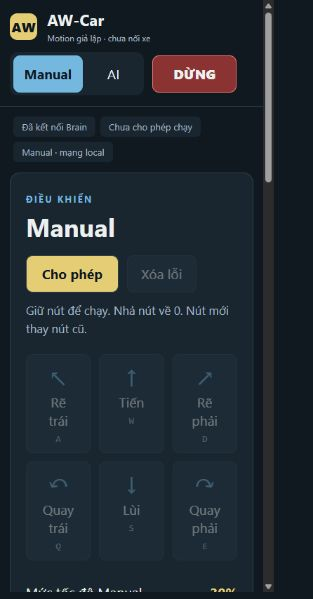

# Brain: Xóa lỗi Motion và xác nhận quyền chạy

Bổ sung ngày 03/11/2026 trên `feat/f03-xiaozhi-ai`; PR #13 giữ draft.
Không merge main. Source Motion nằm ở nhánh `codex/esp32-s3-motion` từ main;
không đưa toàn bộ firmware Motion/RTL/CAD vào nhánh Brain.

## Hành vi

Nút **Xóa lỗi** chỉ mở khi Motion báo FAULT còn mới và chưa có quyền chạy.
Brain tăng epoch, gửi STOP và **đợi ACK đúng STOP trước HELLO mới**, rồi
CLEAR. Chờ STOP tránh HELLO bị flush khi Motion đổi epoch. ACK có thể thuộc
session trước/zero, chỉ giảm quyền; các bước HELLO/CLEAR vẫn khóa đúng phiên.
BUSY chưa phải thành công; chỉ DISARMED/fault=0 sau đúng yêu cầu mới hoàn tất.
Thành công vẫn chưa ARM; phải bấm Cho phép lại. STOP/đổi mode/timeout hủy clear.
AI không được cấp tool ARM/CLEAR. Motion reject ARM được báo ngay.

Socket đóng bỏ nhãn quyền cũ, khóa Cho phép/Xóa lỗi. Thêm Cache-Control:no-store
cho asset HTTP/simulator và sửa hàng nút màn hình hẹp để không tràn ngang.
Giữ nguyên nút nghe, RGB, BOOT, cấu hình mic và profile stock.

## Kiểm chứng

- **84 Python tests, không skip**, gồm CLEAR thành công, sai epoch, stale,
  STOP hủy clear, peer reject, ACK STOP đến trễ/sai sequence và ARM reject.
- **3 Node tests**: sáu hướng, mức tốc độ, last-press và nhả phím.
- Ghép chính hai core C++ Brain/Motion: Manual/AI/ARM/STOP/CLEAR/mất cloud
  đạt. Brain digest `8c48f5e0e849`, Motion digest `e87c3de279a28d70`;
  1.035s thời gian giả lập, FPGA peer Python, không phải UART vật lý.
- Computer use với cùng asset/C++ simulator: FAULT 0x0004 khóa Cho phép;
  Xóa lỗi về DISARMED/0x0000, không tự ARM. Console browser không có JS error.
- Thử viewport 390×844; do host zoom, client CSS rộng 312px. Không tràn ngang;
  hàng nút wrap. Đã kiểm tra desktop 1280×1000 và reset viewport sau thử.
- Socket đóng khi ARMED giả lập: header về chưa xác nhận quyền chạy, bỏ
  class ready và khóa nút. Không diễn giải thành thử trên iPhone thật.
- Repo checker và diff whitespace đạt; ESP-IDF 6.1 build/merge AW-Car và
  build profile stock đạt. App stock hash không đổi so với baseline.

[Ảnh desktop sau clear](brain-motion-clear-desktop.png). Ảnh chỉ chứng minh
UI giả lập; bản mobile mới chụp lại với core cuối, desktop thể hiện cùng UI.

## Firmware mới build, chưa nạp Brain

| Artifact local ignored | Byte | SHA-256 |
| --- | ---: | --- |
| firmware/brain/build/merged-binary.bin, 0x0000 | 8949619 | `5d0797596bc7d4231131c89adcf2de4e903ac0acf9dacfe032b9fa860f3f30ce` |
| firmware/brain/build/xiaozhi.bin | 2662464 | `b757bc3aaa533bc974342e99c329a913fea776dc80e6cd2f272678ca125e26bc` |
| firmware/brain/build/xiaozhi.elf | 34814756 | `e3903caf1f114d437872393eaa26e54d2554976fb69e194ceb3ef0da0681109b` |
| firmware/brain/build/stock/xiaozhi.bin | 2583840 | `922aa67b51847a329ef6b107c581b887f1d805f6debb4910588062c1fad36aac` |

Log build/test và cookie ở build/brain, ignored. Không upload merged image,
NVS hoặc raw log. COM3 không hiện diện trong mốc này, **chưa nạp lại Brain**;
board Brain vẫn là bản Safari đã thử. Motion COM7 đã nạp bản LOCKED riêng.

Còn phải thử UART hai ESP, recovery GPIO/gate, E-stop và motor; chưa đo
latency Wi-Fi/FreeRTOS hoặc xác nhận âm thanh sau bản build mới. Không gọi
ACK/applied_seq là bằng chứng xe đã chuyển động.
