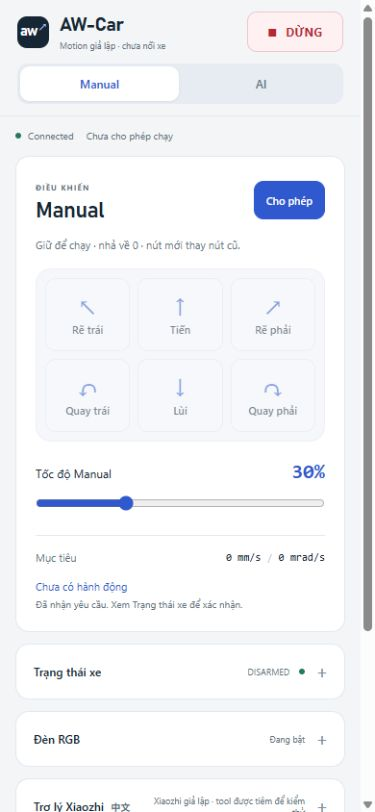

# Brain: ổn định AP+STA, WebSocket và dashboard

Mốc 04/11/2026, nhánh `feat/f03-xiaozhi-ai`, giữ PR #13 ở draft.
Motion ở `codex/esp32-s3-motion`; không merge main hoặc kéo RTL/CAD vào Brain.

## Nguyên nhân và thay đổi

### Wi-Fi

Bản cũ gọi connect mỗi 3 giây, ALL_CHANNEL_SCAN và retry nội bộ SDK.
Khi SSID không có, mỗi lần connect có thể quét lại, chiếm thời gian radio
của SoftAP. APSTA dùng chung radio; kênh AP phải theo STA khi liên kết.
FAST_SCAN chỉ dừng sớm khi tìm được AP phù hợp, không đảm bảo chỉ quét một
kênh khi SSID vắng. Đã xác minh quy trình connect/scan, mất liên kết và lý do
trong [Station Scenarios của Espressif](https://docs.espressif.com/projects/esp-idf/en/v6.1/esp32s3/api-guides/wifi-driver/station-scenarios.html).
Mất Internet/cloud khi STA vẫn có IP không phải lý do tự reconnect Wi-Fi.

`network_policy.h` chạy bằng thời gian đơn điệu, một worker sở hữu state:
no_credentials → waiting → connecting → dhcp → online; lỗi → backoff/cooldown.
Không có credentials thì không scan. Association/DHCP có deadline 15 giây;
backoff 1/2 giây, sau 3 thất bại nghỉ 60 giây. Lỗi xác thực/handshake nghỉ
5 phút; online ổn định 30 giây mới reset burst. Khi có client AP và SSID
vắng, giới hạn một lần thử mỗi 60 giây. Người dùng đổi cấu hình được thử ngay.
Dùng FAST_SCAN, gợi ý kênh từng thành công, tắt retry phụ trong SDK; không có
connect chồng nhau. Không chuyển AP-only và không tắt STA để giữ dashboard.

Callback chỉ đưa event vào queue. Worker kiểm return code, ghi nguyên nhân
STA/AP client disconnect, số lần thử/lỗi, kênh thực, RSSI, DHCP và IP; đối
chiếu số client bằng API. Queue overflow làm AI offline, không cấp quyền mới.
Log sức khỏe không chứa SSID, mật khẩu, MAC, cookie, PIN hoặc hội thoại.
Dashboard có dữ liệu IP/RSSI trong mục chẩn đoán đã xác thực.

### HTTP và WebSocket

Giữ cookie HttpOnly/SameSite, Origin, bind interface AP, một dashboard duy
nhất. Thêm `/api/session` trước upgrade để phân biệt 401/409; JS chặn gửi
form hoặc tạo WS trùng khi đang kết nối. Post-handshake callback mới đánh
dấu kết nối thành công; không dựa vào URI đã bị SDK xóa sau upgrade.

Tất cả send/shutdown diễn ra trong HTTP server task. `close_fn` là nơi duy
nhất gọi close(fd). Không vừa queue trigger_close vừa trả failure cho SDK
đóng trực tiếp: một con trỏ session cũ trong queue có thể trỏ slot tái dùng.
Work dùng fd+generation, tối đa một batch chờ; chỉ serialize khi HTTP task
thực thi. Không cấp phát work trên đường control/UART. Build bắt buộc queue
work không blocking. SDK send WS dùng callback gửi đồng bộ; payload sống hết
lời gọi. `socket_writer.h` hoàn tất positive short-write, đóng khi lỗi/không
có tiến triển hoặc hết deadline gửi, tránh hỏng ranh giới frame. Không sửa SDK/managed_components.
Cách đồng bộ dựa trên [HTTP Server của Espressif](https://docs.espressif.com/projects/esp-idf/en/v6.1/esp32s3/api-reference/protocols/esp_http_server.html)
và source SDK v6.1 cục bộ.

| Mốc | Giá trị | Ý nghĩa |
| --- | --- | --- |
| Manual command TTL / timeout | 120 / 150 ms | Không thay đổi; control task độc lập |
| Motion STATUS stale | 150 ms | Thu quyền độc lập Wi-Fi/WS |
| Dashboard STATUS stale | 350 ms | Khóa UI, STOP được gộp, không flood |
| Application heartbeat WS | 2.000 ms | Dọn phiên mồ côi, không gia hạn motor |
| PING | 1.000 ms | Chẩn đoán transport; PONG không giữ phiên UI sống |
| max_open_sockets | 4 | Giữ nguyên; HTTP thường đóng sau response |
| LRU purge | false | Không để tải asset đẩy WS điều khiển ra |

2 giây là cấu hình thử kết nối, không phải deadline dừng xe. Không tăng số
socket tùy tiện. Theo dõi peak socket, heartbeat/PONG, send/receive/protocol
error, peer close, auth/origin/busy reject, queue failure/delay, stale work và
close code/reason/errno. Với LRU tắt, eviction do LRU bằng 0 theo cấu hình;
không tuyên bố có một event SDK đo eviction riêng. Nếu không có Close frame,
1006/peer_or_sdk_close không xác định chính xác nguyên nhân radio hoặc người dùng.

### Dashboard

Connected / Degraded / Disconnected / Unauthorized được thể hiện riêng.
Mất STATUS chỉ gửi một safety STOP mỗi epoch/phiên, xóa phím và quyền cục bộ;
CHALLENGE không thay STATUS mới. Blur/visibility/pagehide không tạo flood.
Manual ẩn trang đóng WS; AI mất Web giữ đúng contract quyền còn lại. Mất
kết nối không có nghĩa motor đã dừng: UI đánh dấu dữ liệu cũ và chờ xác nhận.
Đăng nhập/reconnect không tự ARM, không phục hồi phím/MOVE đã giữ.

Theo yêu cầu giao diện tối giản: nền sáng, nhóm Manual/AI và DỪNG cố định,
sáu hướng và tốc độ tập trung một khối. Trạng thái xe, RGB, hội thoại, Wi-Fi
và chẩn đoán mở rộng khi cần. AI tự mở hội thoại và giấu cụm lái Manual.
Không thêm framework, CDN, font mạng hoặc ảnh lớn vào ESP32.

## Bằng chứng phần mềm

- 90 root Python tests và 7 Node input/connection tests đạt, kiểm cùng core/transport.
  Policy thử SSID vắng, auth, association/DHCP timeout, flap, online, client
  AP đang hoạt động. Transport thử URI rỗng, 1.000 frame, PING/PONG/CLOSE,
  short-write, lỗi I/O; không queue đóng lần hai.
- Soak mới 120,216 giây thực, 2.400 MOVE/neutral qua đủ sáu hướng,
  2.402 ACK, không reject/error, tối đa 1 request chờ. Handler → mock UART:
  p50 0,0935 ms; p95 0,1493 ms; p99 0,2062 ms; max 0,3361 ms.
  ACK RTT: p50 0,6307; p95 0,8511; p99 1,0271; max 1,8189 ms.
  RSS host cuối khoảng 45,95 MB; trace 256, journal 100, mẫu latency 40.000
  có giới hạn. Đây không phải số đo radio, FreeRTOS hoặc motor.
- Computer use với cùng asset/C++ simulator: login, ARM, RGB, AI, phục hồi
  không tự ARM; desktop và mobile không tràn ngang. Ngừng STATUS 10 giây
  trong khi socket/challenge còn chạy: đúng một STOP và nút lái bị khóa.
  Lần giữ gián đoạn dài hơn cũng chỉ một STOP. Browser không có JS error.
- ESP-IDF6.1 build AW-Car và stock; app stock giữ nguyên baseline.
  Bản thay giao diện cuối chỉ được nạp khi người dùng sửa xong chập GPIO.

[Desktop Connected](brain-network-connected.png), [Degraded](brain-network-degraded.png).
Ảnh và host chứng minh UI/phần mềm, không thay nghiệm thu ESP32.

## Monitor thật và giới hạn nghiệm thu

Đã đọc COM3 Brain và COM7 Motion thật, không suy trạng thái từ host mock.
Nạp các bản chẩn đoán tại 0x0000, hash được esptool xác nhận, giữ NVS và
motioncfg theo byte. Một lần USB mất kết nối giữa lúc nạp Brain; đã nạp lại
thành công và kiểm hash trước chạy. Không có panic/assert/watchdog trong
các cửa sổ log thu được; điều đó không chứng minh toàn hệ thống không thể treo.

- STA thực trả reason 201 (NO_AP_FOUND), AP DHCP chạy; chưa có IP STA.
  Chưa nghiệm thu Xiaozhi Internet/APSTA online trong mốc này.
- Android từng có handshake/heartbeat/PONG; có send failure và timeout
  heartbeat. Chưa khẳng định radio scan là nguyên nhân duy nhất; còn cần
  thử điện thoại foreground sau khi phần cứng ổn định.
- UART trước sửa chập: Brain có byte nhưng rất ít/không STATUS hợp lệ,
  mẫu đầu khung sai. Motion chẩn đoán riêng: UART1 TX17/RX18, baud đo theo
  cấu hình 115201, có parser error; UART2 FPGA không byte/lỗi trong mẫu mới.
  Tổng rx_errors cũ không thể tự quy hết cho cặp dây Brain.
- Brain đã đổi RX từ poll theo tick 10 ms sang UART event threshold/idle,
  tránh chunk khỏe bị scheduler chia qua interbyte timeout 10 ms. Giữ nguyên
  codec/CRC/deadline, vẫn phải đo lại vật lý để xác nhận.
- Người dùng đo lại và xác nhận GPIO17/18 trên Motion đang chập, sẽ rút
  nguồn sửa. Tạm dừng thao tác board trong lúc sửa; chưa kết luận link thông.
  Motion vẫn LOCKED, configured=false, driver/logical GPIO LOW.

Sau sửa phải đo lại STATUS ~20 Hz, age <150 ms, lỗi không tăng trong cửa sổ
thử, STOP/HELLO/ARM reject an toàn hai chiều. Chưa có FPGA/gate/motor trong
vòng đo này; không bật driver hoặc gọi ACK là xe đã chạy. Raw log, binary,
flash/NVS backup và cookie chỉ nằm trong build ignored, không đưa lên Git.
