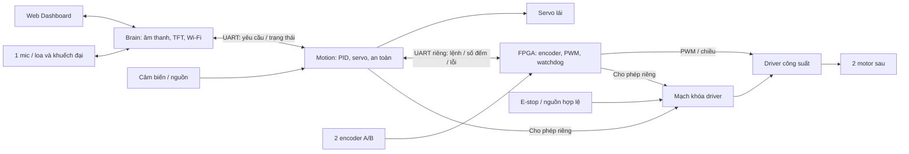

# Kế hoạch FPGA và toàn hệ thống

Ngày chốt phân tải: **23/10/2026**. Đây là kế hoạch thiết kế, chưa có RTL,
kết quả tổng hợp hay phép đo phần cứng. Tài liệu này cập nhật phương án trước
trong [rà soát issue #1](issue-1-technical-review.md).

## 1. Quyết định và giới hạn

- Giữ 2 ESP32-S3, 1 INMP441, servo lái trước và 2 motor sau có encoder.
- Thêm 1 FPGA: đọc 2 encoder A/B, phát PWM/chiều quay cho 2 motor sau, kiểm tra
  lệnh và tự khóa đầu ra khi lệnh Motion quá hạn. PID và servo vẫn ở Motion.
- Chưa mua FPGA. Viết RTL/testbench trước, dùng kết quả trên chip ứng viên để
  chọn board. Ngân sách board và bộ nạp dưới 500.000đ; tính thêm phụ kiện/ship.
- Tang Nano là ứng viên; không mặc định bản 1K chứa được toàn bộ RTL.
- Nhắm 3 môn: Tích hợp hệ thống cảm biến, Lý thuyết mạch, RTL/FPGA. Bỏ mục tiêu
  môn PCB khuếch đại; loa/IC khuếch đại phục vụ giọng nói vẫn thuộc xe.
- DoA dành cho nâng cấp, chưa có trong cấu hình 1 mic. Bản chạy đầu chỉ tiến
  trong vùng bảo vệ đã thử; mở lùi sau khi có cảm biến/vùng bảo vệ phù hợp.

## 2. Phân công toàn hệ thống

| Khối | Trách nhiệm | Dữ liệu/đầu ra chính |
| --- | --- | --- |
| Dashboard | Một phiên điều khiển, dead-man/lease, hiển thị tốc độ, nguồn, lỗi và độ mới dữ liệu | Yêu cầu vận tốc/góc lái; không gửi duty trực tiếp |
| Brain ESP32-S3 | Web/Wi-Fi, TFT/LVGL/QR, 1 mic, Xiaozhi, loa, cảnh báo thiết yếu cục bộ; phân xử Web/giọng nói | Lệnh chuyển động có giới hạn/hạn dùng tới Motion qua UART |
| Motion ESP32-S3 | Đọc cảm biến, kiểm tra lease, tính tốc độ và PID 2 bánh, hình học lái, servo, arm/fault và an toàn | Duty/chiều/quyền chạy tới FPGA; khóa driver phần cứng; telemetry tới Brain |
| FPGA | Đồng bộ/giải mã encoder, chốt số đếm, timer, PWM 2 kênh, parser, watchdog và FSM | PWM/chiều tới driver; số đếm, sequence, lỗi/trạng thái tới Motion |
| Driver công suất | Cầu H cấp dòng motor theo tín hiệu logic; chế độ phanh/thả trôi theo datasheet | Điện áp/dòng cho 2 motor; chọn theo dòng kẹt và nhiệt thực |
| Servo/cơ khí | Lái trước trong giới hạn đã hiệu chuẩn, hình học Ackermann cần kiểm chứng | Góc lái và bán kính quay; xe không quay tại chỗ |
| Cảm biến | ToF/vật cản, phản xạ nền/mép rơi, IMU, lực va chạm, dòng/nguồn, môi trường theo BOM chốt | Mẫu có tuổi/hợp lệ; Motion quyết định mức nghiêm trọng |
| Nguồn và mạch dừng | Pin, sạc đúng hóa học, BMS, cầu chì, rail motor/servo/logic/âm thanh/FPGA, khóa driver | Cấp nguồn đủ dòng; E-stop và trạng thái tắt mặc định độc lập phần mềm |

FPGA không thay driver, Motion hay nguồn công suất. PWM servo vẫn do Motion
phát; không chuyển xử lý âm thanh, mạng, PID hay toàn bộ cảm biến sang FPGA.

## 3. Phạm vi RTL đầu tiên

| Module chức năng | Yêu cầu kiểm chứng |
| --- | --- |
| Đồng bộ và lọc encoder | Tín hiệu A/B bất đồng bộ qua bộ đồng bộ; ngưỡng lọc không loại xung hợp lệ ở RPM cao nhất |
| Giải mã 2 encoder | Đếm có dấu/chiều, quy ước x1/x2/x4 rõ ràng, phát hiện chuyển trạng thái bất thường; quy định wrap và lấy delta |
| Timer và snapshot | Chốt đồng thời số đếm 2 bánh, sequence và trạng thái; không trộn nửa cũ/nửa mới trong frame |
| PWM 2 kênh | Tần số/độ phân giải tham số hóa, duty 0%/100% rõ ràng, chặn ngoài miền; cập nhật cặp lệnh ở ranh giới chu kỳ |
| Điều khiển chiều | Lệnh tiến/lùi/phanh theo driver đã chọn; đổi chiều phải về trạng thái dừng và qua trình tự chuyển đã kiểm chứng |
| UART RX/TX và parser | Khung có giới hạn độ dài, phiên bản, session, sequence, CRC và tái đồng bộ; frame sai không ghi đầu ra |
| FSM và watchdog | Boot/reset DISARMED; chỉ arm sau handshake mới và lệnh zero; timeout mất quyền chạy; lỗi nghiêm trọng chốt FAULT, cần phục hồi chủ động |

Lõi dùng Verilog/RTL tổng hợp được, tham số hóa clock/timer/độ rộng đếm; tách
primitive clock/reset/IO riêng cho từng hãng khi cần. Không đưa PLL/IP riêng
Quartus vào lõi rồi coi như tương thích Gowin. CDC và reset phải có thiết kế
rõ ràng; mô phỏng chức năng không tự chứng minh hết rủi ro metastability.

Mục tiêu khởi đầu để đánh giá: PID và lệnh Motion-FPGA 100 Hz, PWM khoảng
20 kHz với độ phân giải hữu dụng ít nhất 10 bit, snapshot encoder mỗi 10 ms,
timeout lệnh FPGA khoảng 50 ms. Đây là **đề xuất cần đo/chốt theo motor và
clock ứng viên**, không phải thông số đã đạt. Tránh phép chia/tính PID trong
FPGA bản đầu; Motion chuyển đổi số đếm sang m/s và tạo giá trị duty phù hợp.

## 4. Giao tiếp và an toàn

Hai liên kết độc lập: Brain-Motion giữ đặc tả lease trong bản rà soát; liên kết
Motion-FPGA dự kiến UART 3.3 V, 115200 8N1, dây ngắn và chung GND. Ví dụ khung
tối đa 32 byte mỗi chiều, 100 Hz cần 32.000 bit/s mỗi chiều gồm start/stop,
dưới 115200 bit/s; vẫn phải đo latency và lỗi khi motor chạy. Đây chưa là wire
format; phải chốt byte order, CRC, session/sequence wrap và các miền giá trị.

- Motion gửi duty trái/phải, chiều, yêu cầu arm/disable và sequence của bước
  điều khiển mới. Chỉ lệnh mới/hợp lệ/đúng phiên khi ARMED mới gia hạn watchdog.
  Frame lặp, heartbeat hoặc telemetry không duy trì quyền chạy.
- FPGA trả số đếm snapshot, sequence, trạng thái arm/fault và lỗi. Motion tự
  tính tuổi dữ liệu; bản tin còn đến nhưng snapshot/sequence đứng yên vẫn là lỗi.
- Motion chỉ tạo lệnh chạy mới khi lease Brain, cảm biến thiết yếu và vòng PID
  còn hợp lệ. Tác vụ UART không tự phát lại duty cache nếu tác vụ điều khiển treo.
- Handshake/arm không tự chạy lại setpoint cũ. Reset một trong hai đầu, đổi
  session, mất lệnh hoặc nhả E-stop đều cần arm lại chủ động với đầu ra zero.
- Có đường Motion inhibit/enable phần cứng riêng ngoài UART. Khái niệm cho
  phép driver là AND của FPGA permit, Motion permit, E-stop OK và nguồn hợp lệ;
  chi tiết điện phải theo driver thực, có trạng thái tắt mặc định.
- FPGA đang cấu hình/mất nguồn có thể có chân Hi-Z: dùng pull-down và mạch
  gate bên ngoài để driver không chạy; RTL zero không bảo vệ giai đoạn chưa nạp.
- Watchdog trong FPGA cần clock FPGA. Khi clock/logic FPGA đứng, Motion phải
  khóa driver qua đường riêng nếu phản hồi quá hạn; không gửi lệnh stop qua
  chính đường UART đang lỗi rồi mặc định đã dừng. Xét watchdog phần cứng độc
  lập theo phân tích lỗi, đặc biệt lỗi chung khiến cả hai khối không phản ứng.
- E-stop khóa driver/cắt năng lượng motor độc lập Brain, Motion và clock FPGA.
  Servo có chính sách giữ góc/ngừng xung/ngắt nguồn theo phép thử cơ khí; không
  mặc định đánh lái về giữa đột ngột là an toàn.

| Tình huống | Phản ứng cần chứng minh |
| --- | --- |
| Mất Web/Internet hoặc Brain treo/reset | Lease hết, Motion bỏ arm/khóa driver; FPGA hết hạn nếu Motion không còn gửi lệnh |
| Motion treo/reset hoặc UART Motion-FPGA mất | FPGA hết hạn lệnh, khóa PWM/permit; không tự arm khi nối lại |
| FPGA treo/mất clock, UART TX lỗi hoặc telemetry cũ | Motion phát hiện dữ liệu quá hạn và khóa driver bằng đường riêng |
| FPGA reset/chưa cấu hình/mất nguồn | Gate bên ngoài giữ driver tắt cả trước khi RTL hoạt động; Motion bỏ arm |
| Vật cản, mép rơi, nghiêng, va chạm, kẹt hoặc quá dòng | Motion ưu tiên dừng/khóa theo mức lỗi; không chờ AI/loa/Web; fault nặng chốt |
| Brownout, E-stop hoặc ngắt nguồn motor | Mạch phần cứng đưa về tắt mặc định; phục hồi nguồn/nhả nút không tự chạy |

Khóa driver không đồng nghĩa phanh chủ động: TB6612FNG STBY LOW là Hi-Z/thả
trôi. Chọn driver và chế độ dừng rồi đo quãng dừng, cộng toàn bộ thời gian cảm
biến/lọc/lease/UART/PID/watchdog. Không cộng thông số danh nghĩa rồi coi là đủ
an toàn cho mọi vận tốc; giới hạn vận hành theo vùng phát hiện và tải thực.

## 5. Luồng công cụ và điều kiện chọn board

`Đặc tả -> RTL + testbench -> mô phỏng -> chip tham chiếu -> báo cáo tài nguyên
và timing -> chip/board ứng viên -> tổng hợp + place-and-route + timing đúng
chip -> chốt mua -> thử trên bàn -> tích hợp xe`.

Quartus nhắm chip Altera/Intel được phiên bản đó hỗ trợ; không tạo bitstream
cho Gowin trên Tang Nano. Có thể dùng Quartus để học/đánh giá lõi trên một chip
tham chiếu cụ thể, nhưng kết quả LE/ALM/FF của chip đó không quy đổi trực tiếp
ra LUT4/FF Gowin. Nếu đích vẫn là Tang Nano, phải dùng Gowin trên đúng chip
ứng viên **trước khi chốt mua**. Không cần có board để tổng hợp hoặc phân tích
timing, nhưng cần ràng buộc clock/I/O đúng và mô hình ngoại vi phù hợp.

Không chọn board chỉ theo số thanh ghi. Ghi lại cho mỗi chip ứng viên:

- LUT/logic, FF, RAM, DSP, PLL, chân IO thực sự còn dùng được và dư địa mở rộng;
  có thể dùng một mục tiêu ban đầu là còn 20-30% logic/FF, rồi đánh giá timing.
- Place-and-route thành công, timing đạt với ràng buộc đầy đủ, rà CDC/reset;
  không lấy synthesis đơn thuần thay kết quả sau bố trí/định tuyến.
- Điện áp từng bank IO, mức ngõ ra encoder/driver; encoder 5 V cần giao tiếp
  phù hợp. Không cấp dòng motor qua FPGA, MCU hoặc breadboard.
- Clock, bộ nạp, phần mềm/license, khả năng lưu cấu hình và tự chạy khi cấp
  nguồn không có máy tính; không lấy user flash làm số đo bộ nhớ cấu hình.
- Nguồn và dòng tiêu thụ theo board; rail motor/servo riêng phù hợp tải, chống
  sụt áp/nhiễu cho logic và âm thanh, chung GND được bố trí đúng.
- Tổng chi phí board/bộ nạp/phụ kiện/vận chuyển, nguồn cung và khả năng thay thế.

Hiện chưa có RTL hay kết quả mô phỏng/tổng hợp. Chưa chạy Quartus/Gowin; lần
kiểm tra môi trường chưa tìm thấy Quartus/iverilog/Verilator/Yosys trong PATH,
không kết luận các phần mềm chưa được cài ở vị trí khác.

## 6. Nghiệm thu theo giai đoạn và 3 môn

1. Đặc tả: chốt trạng thái, giao thức, đơn vị, tần số/độ phân giải, timeout,
   tiêu chí sai số/tốc độ/quãng dừng và motor/encoder/driver ứng viên.
2. RTL: mô phỏng tick tiến/lùi, xung nhiễu, trạng thái A/B sai, đếm wrap,
   snapshot nhất quán, duty biên, đổi chiều, CRC/length/session/sequence lỗi,
   timeout, reset giữa khung/PWM và không tự chạy lại. Mô hình MCU/driver kiểm
   tra hành vi hai đầu; thử clock đứng phải quan sát cả đường inhibit ngoài FPGA.
3. Tổng hợp: lưu tool/version, mã chip, tham số, constraints, tài nguyên,
   cảnh báo và timing sau place-and-route; sửa trước khi mua.
4. Trên bàn: xung encoder giả rồi encoder thật, đo PWM/chiều và trạng thái gate,
   rút UART, reset/tắt từng board theo mọi thứ tự; motor ban đầu nhấc khỏi đất.
5. Tích hợp: PID, servo, cảm biến và hình học lái; thử quãng dừng, kẹt/quá dòng,
   nguồn yếu và tải đồng thời Wi-Fi/TFT/loa/motor; Dashboard báo dữ liệu cũ/lỗi.
6. Motherboard sau khi nguyên mẫu đạt; ghi lại sơ đồ nguồn/mức logic/gate và kết
   quả nhiễu/nhiệt. DoA là giai đoạn riêng sau bản đầu.

| Môn | Phần đóng góp | Bằng chứng cần có |
| --- | --- | --- |
| Tích hợp hệ thống cảm biến | Encoder-FPGA-Motion, cảm biến an toàn/nguồn, Brain/Dashboard | Hiệu chuẩn, độ mới dữ liệu, PID và thử lỗi/liên kết toàn hệ thống |
| Lý thuyết mạch | Mô hình R-L và sức phản điện động motor, PWM/dòng khởi động, sụt áp/nguồn, lọc RC và đo dòng | Tính toán, mô phỏng mạch và đối chiếu dạng sóng/số đo; cần xác nhận phù hợp rubric môn |
| RTL/FPGA | Encoder, timer, PWM, UART, FSM/watchdog | Testbench, waveform, RTL tổng hợp được, báo cáo tài nguyên/timing và thử board |

## 7. Nguồn

- [Sipeed: thông số Tang Nano 1K](https://wiki.sipeed.com/hardware/en/tang/Tang-Nano-1K/Nano-1k.html).
- [Sipeed: Gowin IDE, thiết bị được hỗ trợ và Programmer](https://wiki.sipeed.com/hardware/en/tang/common-doc/get_started/install-the-ide.html).
- [Altera: Quartus Prime](https://www.altera.com/products/software-tools/quartus-prime): trang hãng được tìm qua chỉ mục tìm kiếm; mở trực tiếp trả 403 khi đối chiếu, chưa đọc đầy đủ bảng hỗ trợ chip theo phiên bản.
- Các nguồn motor/driver, nguồn, cảm biến và ESP32 trong [bản rà soát](issue-1-technical-review.md#10-nguồn-kỹ-thuật-đã-đối-chiếu).
