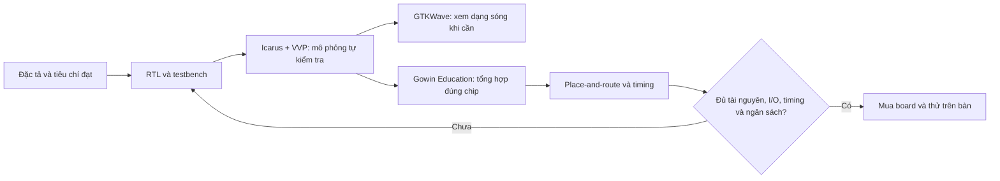

# Kế hoạch thiết kế và kiểm thử RTL FPGA

Ngày nghiên cứu: **23/10/2026**. Đã triển khai/mô phỏng phần reset, encoder,
snapshot, PWM/chiều độc lập driver và UART/parser/CRC/serializer/guard;
xem [FPGA](../fpga/README.md). Các phần còn lại
là kế hoạch; chưa có kết quả tài nguyên toàn lõi hoặc timing.
Phân tải đã chốt ở [kế hoạch toàn hệ thống](fpga-drive-plan.md).

## 1. Hướng thực hiện

**Không cần Quartus và chưa cần mua board.** Làm trên máy Windows hiện tại:



| Việc | Công cụ/địa điểm | Kết quả có giá trị đến đâu |
| --- | --- | --- |
| Biên dịch và chạy testbench | Icarus Verilog + VVP, Windows; sau đó CI Linux | Chứng minh hành vi theo mô hình và ca thử, chưa chứng minh mạch điện |
| Xem sóng | GTKWave trên Windows | Hỗ trợ tìm lỗi; ảnh sóng không thay kết quả tự kiểm tra |
| Tổng hợp, bố trí/định tuyến, timing | Gowin EDA **Education**, Windows, chọn đúng chip/package/speed grade | Đánh giá ứng viên Tang Nano trước khi mua |
| Kiểm tra tổng hợp sớm/dự phòng | Yosys; khi cần thêm nextpnr-himbaechel + Apicula | Yosys riêng chưa đủ kết luận timing hoặc board phù hợp |

Sipeed xác nhận Nano 1K được hỗ trợ bởi Gowin Education, bản Education không
cần license. Tải IDE có thể cần tài khoản hãng. Quartus dành cho chip Altera/
Intel; không có bước bắt buộc tổng hợp Quartus rồi mới chuyển sang Tang Nano.

Apicula cũng liệt kê **GW1NZ-LV1QN48C6/I5 / Tang Nano 1K** và có ví dụ tương
ứng. Vì vậy nếu Gowin không chạy được, có thể thử Yosys -> nextpnr-himbaechel
-> `gowin_pack`. Phải kiểm tra bản công cụ/chip database thực tế, constraints
và timing; không mặc định kết quả hai bộ công cụ tương đương. Luồng Gowin là
đường chính để quyết định mua trong kế hoạch này.

### Thiết lập tối thiểu ở phiên triển khai

1. Tải **OSS CAD Suite windows-x64** từ release chính thức, giải nén vào đường
   dẫn không có khoảng trắng, ví dụ `C:\Tools\oss-cad-suite`. Bộ này có Icarus,
   VVP, GTKWave, Yosys và các công cụ khác; chưa cần học hết hoặc thêm cocotb/UVM.
2. Mở môi trường bằng `environment.ps1` theo README của bộ công cụ; kiểm tra
   `iverilog -V`, `vvp -V`, `yosys -V`. Ghi phiên bản/release cố định cho nhóm.
3. Cài Gowin Education; kiểm tra chọn được đúng mã chip 1K và chạy được một
   thiết kế thử nhỏ trước khi đầu tư viết toàn bộ RTL. Chưa cần cắm board.
4. Nếu bộ Windows có lỗi, chuyển phần mô phỏng sang OSS CAD Suite linux-x64
   trong WSL2/Ubuntu. Dự án OSS CAD Suite khuyên WSL cho trải nghiệm Windows;
   đây là phương án dự phòng, không phải điều kiện phải cài ngay.

Lần kiểm tra môi trường này chưa thấy `iverilog`, `vvp`, `verilator`, `yosys`,
`nextpnr-himbaechel`, `gw_sh` trong PATH hoặc các thư mục công cụ đã dò. Có
`wsl.exe`, nhưng chưa xác minh distro. Không kết luận phần mềm chưa tồn tại
ở vị trí khác. Đó là kết quả lúc lập kế hoạch; phiên triển khai đã chuẩn bị
Icarus 13.0 MSYS2 cục bộ và chạy ba testbench encoder, xem README FPGA.

## 2. Ranh giới thiết kế và thông số ban đầu

FPGA nhận **duty/chiều**, không nhận trực tiếp lệnh giọng nói hay vận tốc.
FPGA đọc 2 encoder, chốt số đếm, phát PWM/chiều cho driver và tự hết hạn lệnh.
Motion tính vận tốc/PID, đọc cảm biến, điều khiển servo và có đường khóa driver
riêng. Brain giữ Web, âm thanh và TFT; driver vẫn cấp dòng cho motor.

Đề xuất cấu hình đánh giá đầu tiên, **chưa phải thông số đã nghiệm thu**:

| Tham số | Giá trị dự kiến | Lý do/điều kiện |
| --- | --- | --- |
| Clock lõi | 27 MHz; một clock domain, không PLL bản đầu | Clock onboard Nano 1K; target khác phải đổi tham số/constraints |
| PWM | Edge-aligned, 20 kHz, chu kỳ 1.350 tick | 27.000.000 / 1.350 = 20.000 Hz; counter 11 bit |
| Duty | Số nguyên 0..1.350; 0 tắt, 1.350 bật cả chu kỳ | Bước 1/1.350, hơn 10 bit hữu dụng; ngoài miền bị từ chối |
| Encoder | X4, 2 bộ đếm 32 bit modulo | Motion lấy delta có dấu; cần chứng minh delta giữa mẫu nhỏ hơn 2^31 |
| Snapshot/lệnh PID | 10 ms / 100 Hz | Chốt đồng thời hai bánh; vòng PID thật còn cần đo jitter |
| Watchdog chạy | 50 ms từ lệnh mới hợp lệ cuối cùng | 1.350.000 tick, không gia hạn bằng heartbeat/frame lỗi |
| Motion phát hiện FPGA cũ | 30 ms không nhận snapshot mới đúng phiên; hạ permit trong 1 ms tiếp theo | Mục tiêu phải đo cùng scheduler Motion; frame lặp không làm mới hạn |
| UART | 115200, 8N1, full-duplex, logic 3,3 V | Dây ngắn, GND chung; encoder/driver 5 V cần giao tiếp mức |
| Độ dài frame | Tối đa 32 byte mỗi chiều | 100 frame/s dùng tối đa 32.000 bit/s mỗi chiều |

Không dùng counter PWM 10 bit chạy tự do rồi gọi là 20 kHz: với 27 MHz, cách
đó cho khoảng **26,37 kHz**. Cũng không chọn board chỉ theo số FF: LUT, RAM,
chân I/O, mapping, timing và điều kiện điện đều ảnh hưởng.

## 3. Chia module RTL

Toàn bộ RTL và testbench dùng **SystemVerilog, đuôi `.sv`**. RTL dùng `logic`,
`always_ff`/`always_comb` và enum khi phù hợp; giới hạn trong tập con tổng hợp
được bằng Yosys/Gowin. Icarus bật `-g2012`, Yosys bật `read_verilog -sv`.
Hook/CI kiểm tra đuôi nguồn; chỉ wrapper chứa primitive/constraints riêng hãng.
Tất cả timer dùng clock-enable trong domain 27 MHz, không tạo clock bằng logic.

| Khối dự kiến | Trách nhiệm và giao diện chính |
| --- | --- |
| `reset_sync`, `input_sync_filter` | Reset assert bất đồng bộ, nhả đồng bộ; mỗi A/B, RX và tín hiệu ngoài có bộ đồng bộ phù hợp; lọc A/B theo số mẫu ổn định |
| `quadrature_decoder` x2 | A/B đã lọc -> count32, lỗi chuyển trạng thái; đếm từng cạnh X4, bảng 16 chuyển trạng thái |
| `snapshot_timer` | Mỗi 10 ms chốt đồng thời count trái/phải, timestamp, snapshot sequence và trạng thái |
| `pwm_pair` | Một timebase chung, duty shadow -> active đồng thời tại đầu chu kỳ; output bị khóa khi không được phép |
| `motor_sequencer` | Chuẩn hóa chiều trái/phải và trình tự đổi chiều; adapter chân IN1/IN2/PWM theo driver thực |
| `uart_rx`, `uart_tx` | Byte RX/TX, framing error/break, busy/valid; không tác động trực tiếp PWM |
| `frame_rx`, `frame_tx`, `crc16` | Parser có giới hạn/tái đồng bộ; CRC streaming; TX giữ snapshot bất biến suốt frame |
| `command_guard`, `safety_fsm` | Kiểm tra phiên/sequence/miền giá trị; phát lệnh cặp nguyên tử; DISARMED/ARMED/FAULT, watchdog và fault latch |
| `drive_core`, wrapper target | Nối các khối, ưu tiên reset/fault; pinout, điện áp, reset khởi động và gate ngoài thuộc target/phần cứng |

### Encoder và CDC

- Quy ước dương đề xuất: `00 -> 01 -> 11 -> 10 -> 00` là +4 count; có tham số
  đảo chiều từng bánh theo cách lắp. Giữ nguyên trạng thái không tăng count;
  nhảy hai bit báo invalid, không suy đoán +2/-2.
- Hai FF đồng bộ mỗi tín hiệu là điểm xuất phát; không đưa tín hiệu ngoài vào
  nhiều đường logic trước khi đồng bộ. Mô phỏng không mô hình hóa metastability;
  cần review cấu trúc, thuộc tính synchronizer và constraint sau mapping.
- Với PPR là số chu kỳ kênh A trên **trục encoder**, `f_count = 4*PPR*RPM/60`.
  Nếu encoder trước hộp số, dùng tốc độ trục motor hoặc nhân đúng tỉ số truyền.
  Không nhân X4 lần nữa nếu datasheet đã ghi CPR sau giải mã.
- Chọn `FILTER_N` sau khi có PPR/RPM tối đa và dạng xung: khoảng cách ngắn nhất
  giữa hai chuyển trạng thái hợp lệ phải lớn hơn tổng trễ đồng bộ/lọc và biên
  dự phòng. Test pha bất đồng bộ, lệch A/B và chạy 1,5 lần tốc độ thiết kế.
  Chưa có motor cụ thể nên chưa hứa tần số encoder tối đa.
- Khi snapshot trùng một cạnh đếm, quy định lấy count **trước cập nhật cạnh
  đó**, cạnh được tính ở mẫu tiếp theo; hai bánh dùng cùng quy tắc. Snapshot
  sequence chỉ tăng khi có mẫu mới, không tăng chỉ vì TX gửi lại dữ liệu.
  Timestamp32 dùng tick clock lõi, modulo 2^32 (khoảng 159 giây ở 27 MHz);
  Motion xử lý wrap và dùng đồng hồ cục bộ để xét tuổi dữ liệu nhận được.

### PWM, đổi chiều và an toàn

- Lệnh cặp trái/phải chỉ commit khi mọi kiểm tra đạt. Duty mới lên active tại
  boundary PWM kế tiếp; trễ commit duty **cùng chiều** dưới hoặc bằng 50
  microsecond. Khi đổi chiều, hạn này tính sau khi sequencer hoàn tất điều
  kiện cho phép. Lệnh sau thay toàn bộ shadow, không trộn trái mới/phải cũ.
- DISABLE, watchdog và fault khóa PWM/permit ngay ở chu kỳ clock xử lý sự kiện,
  không chờ boundary PWM. Tại tick hết hạn, timeout thắng lệnh đến cùng tick.
- Đổi chiều: PWM về zero -> chờ khoảng zero đã cấu hình -> đổi chân chiều ->
  chờ setup theo driver -> cho duty mới tại boundary. Hủy lệnh đang chờ nếu có
  disable/fault. Khoảng zero logic không chứng minh rotor đã dừng; Motion phải
  kiểm tra tốc độ trước khi cho đảo chiều. Bản xe đầu chỉ cho tiến.
- Không tự thiết kế dead-time cầu H rời ở bản này. Chốt driver và truth table
  trước khi viết adapter; STBY LOW của TB6612FNG là thả trôi, không phải phanh.
- FSM khởi động DISARMED; ARM cần handshake mới và lệnh zero; ARMED không tự
  khôi phục sau mất lệnh/reset. Khi ARM_ZERO được chấp nhận, khởi tạo watchdog
  50 ms từ thời điểm đó với duty zero; nếu không có CMD mới thì vẫn timeout.
  Chỉ CMD hợp lệ khi ARMED mới gia hạn tiếp. Timeout/lỗi an toàn chuyển FAULT,
  clear lỗi chỉ khi nguồn lỗi đã hết và có thao tác phục hồi; sau clear vẫn DISARMED.
- Gate ngoài FPGA là AND của FPGA permit, Motion permit, E-stop OK và nguồn
  hợp lệ. Pull-down/mạch gate phải giữ driver tắt lúc FPGA chưa cấu hình/Hi-Z.
  E-stop khóa đường điện độc lập; đọc E-stop vào RTL chỉ để phản ánh trạng thái.
  Đường khóa phải chốt sự kiện E-stop/nguồn lỗi hoặc có cơ chế phục hồi tương
  đương: nhả nút/nguồn tốt trở lại không được tự mở gate khi permit cũ vẫn HIGH.
  Chốt mạch và tín hiệu fault vào FSM trước khi triển khai; RTL phải bỏ arm
  khi nhận sự kiện khóa và yêu cầu lại handshake, kể cả xung lỗi ngắn. Chỉ
  clear chốt gate sau khi hai permit cũ đã LOW và điều kiện lỗi được xác nhận hết.
- Watchdog FPGA cần clock. Motion phát hiện telemetry/snapshot đứng và hạ
  permit riêng; thử clock FPGA dừng phải có mô hình Motion/gate bên ngoài.
  Mục tiêu ban đầu: quá 30 ms từ snapshot mới hợp lệ cuối cùng, hạ permit
  trong 1 ms tiếp theo; kiểm tra cả UART còn gửi frame nhưng snapshot đứng.
  Snapshot mới phải đúng phiên và sequence tiến theo modulo; frame cũ/đảo
  thứ tự không gia hạn. Chốt quy tắc wrap/reset cùng giao thức.
  GPIO permit tĩnh riêng lẻ chưa chống được mọi lỗi treo MCU; đánh giá watchdog
  ngoài nếu yêu cầu phải bao phủ lỗi chung. Servo vẫn cần phép thử cơ khí riêng.

### Giao thức: chốt đặc tả trước khi code parser

Đã chốt/triển khai tầng truyền ở [wire protocol v1](../firmware/shared/fpga-protocol.md)
với vector chung Motion. Frame có preamble A5/5A, version/type/length mỗi
trường1 byte, session32, sequence16, payload và CRC16. Little-endian cho số
nhiều byte; CCITT-FALSE (poly1021, initFFFF, không reflection/xor-out), CRC
từ version đến hết payload. Guard cần quyền phiên từ FSM ngoài; handshake
chống frame cũ/ARM chưa được nghiệm thu và còn ở bước safety. Parser không
tự cấp phiên hoặc bật motor.
CRC phát hiện lỗi truyền, không phải cơ chế xác thực chống kẻ tấn công.

- `HELLO`, `ARM_ZERO`, `CMD`, `DISABLE`, `CLEAR_FAULT`, `STATUS` có type/độ dài cố
  định; reserved bits phải zero. `CMD` dùng payload 6 byte cho flags,
  chiều và hai duty16: frame 19 byte, thời gian truyền khoảng 1,65 ms.
- STATUS có count32 x2, timestamp32, snapshot sequence16, state8, fault16 và
  encoder_status8: payload18 byte, frame31 byte, khoảng2,69ms. Offset/vector
  ở đặc tả chung. Phản hồi ARM/handshake an toàn còn thuộc bước safety.
- Chỉ `CMD` mới, CRC đúng, phiên đúng, miền đúng **khi ARMED** gia hạn watchdog.
  Sequence16 dùng delta modulo: `0 < delta < 32768`; cho phép mất frame,
  loại duplicate/cũ, thử wrap 65535 -> 0. Watchdog hết là hủy phiên chạy.
- Parser bỏ frame khi đạt hạn2ms giữa byte hoặc5ms toàn frame (timeout thắng
  byte đến đúng hạn); giữ bounded state, không chờ vô hạn length sai. Hỏng frame
  không ghi setpoint hoặc ngăn watchdog hết hạn. Sau lỗi phải nhận lại được
  frame hợp lệ mà không reset FPGA; kiểm thử cả byte giống preamble trong payload.
- Motion tạo session mới khi kết nối lại, xóa hàng đợi TX/RX cũ, chỉ phát CMD
  từ bước PID còn hợp lệ. **Cần chốt trước triển khai ARM:** cách phát hiện
  reset FPGA, handshake hai chiều và bảo đảm phiên mới/không arm bằng frame
  cũ còn trong buffer. Không coi session32 tự nó giải quyết reset hai đầu;
  cân nhắc tín hiệu phục hồi riêng hoặc boot identity/challenge phù hợp.
- Không cấp phiên mới/arm chỉ vì cổng UART hoạt động trở lại. DISABLE hợp lệ
  phải làm giảm quyền chạy; yêu cầu phục hồi/ARM tuyệt đối không được tăng duty.

Ưu tiên parser streaming và serializer từ thanh ghi snapshot; không mặc định
RX/TX mỗi bên có FIFO 32 byte: riêng hai buffer đó đã có 512 bit lưu trữ nếu
map bằng FF. Tổng hợp sớm để kiểm tra FF/LUT; không bỏ CRC/watchdog hoặc cắt
count tùy tiện để ép vừa board 1K. Không chèn CPU mềm/PID/phép chia động.

## 4. Điều kiện kiểm thử

Testbench tự đối chiếu với reference model, báo lỗi bằng `$fatal`, kết thúc
thành công khi mọi so sánh đạt; mỗi test có timeout để tránh treo regression.
Không chỉ nhìn waveform và kết luận đúng. Stimulus UART/encoder phải độc lập
với cấu trúc bộ đếm/decoder trong DUT, dùng pha/clock riêng để tránh test tự
sao chép lỗi RTL. Kiểm tra output không X/Z sau khi nhả reset.

| Nhóm | Ca thử tối thiểu | Điều kiện đạt |
| --- | --- | --- |
| Reset/CDC | Boot, reset giữa frame/PWM, nhả reset ở nhiều pha, input ban đầu bất kỳ | Không arm/chạy ngoài ý muốn; permit tắt; đồng bộ/nhả reset đúng cấu trúc |
| Encoder | Cả 16 chuyển A/B, thuận/ngược, đứng yên, đảo pha, hai bánh khác tốc độ, wrap 32 bit | Count/delta đúng reference; invalid không tự sinh count; đảo chiều đúng quy ước |
| Filter | Nhiễu quanh ngưỡng N-1/N/N+1 mẫu sau đồng bộ, lệch pha bất đồng bộ; tốc độ 1,5x mục tiêu | Đúng chính sách lọc; không mất/thêm count trong miền đã đặc tả |
| Snapshot | Cạnh encoder trùng tick, wrap timestamp/sequence, cập nhật count khi TX đang gửi | Hai bánh/timestamp/status cùng snapshot; frame đang gửi không bị thay một phần |
| PWM | Duty 0/1/giữa/1.349/1.350 và ngoài miền, update sát boundary | Chu kỳ 1.350 tick; số tick HIGH đúng duty; cặp cập nhật nguyên tử; không có xung ngoài lịch |
| Chiều | Đổi chiều dưới tải mô phỏng, nhiều CMD trong khoảng chờ, disable/fault đúng lúc commit | PWM zero trong khoảng bắt buộc; chiều chỉ đổi đúng trình tự; không phục hồi duty cũ |
| UART/parser | Toàn bộ giá trị byte, ±2% baud phát, start/stop sai, break, cắt/nối frame, length/CRC/version/type sai, rác dài | Frame lỗi không commit/gia hạn; RX phục hồi sau rác; không tràn bộ đệm/state |
| Phiên/sequence | Duplicate, cũ, nhảy sequence, wrap, sai session, frame cũ sau reset/reconnect | Chỉ lệnh mới đúng phiên được nhận; không tự arm; handshake chống buffer cũ đúng đặc tả |
| FSM/watchdog | Không CMD sau ARM; 49/50/51 ms; heartbeat/CRC sai liên tục; CMD đúng tick timeout; reset ở từng bước ARM/CLEAR_FAULT | Timeout thắng ở hạn; PWM/permit tắt chậm nhất 1 tick sau hạn đã định; reset/clear không chạy lại duty cũ |
| Toàn hệ thống mô phỏng | Brain lease hết, PID treo nhưng UART còn hoạt động, Motion reset, FPGA reset/mất clock/TX đứng; stale data trước/tại/sau 30 ms; xung E-stop/nguồn lỗi rồi phục hồi | Motion ngừng CMD; snapshot cũ không gia hạn; permit hạ trong hạn 30+1 ms; khóa lỗi chốt, nhả lỗi không tự chạy |

Một tick 27 MHz khoảng 37,04 ns; tiêu chí watchdog trên đây là phản ứng logic
sau hạn, chưa cộng trễ gate/driver và quãng trôi motor. Khi FPGA mất clock,
không áp tiêu chí 1 tick cho chính FPGA; yêu cầu Motion/gate độc lập phải được
kiểm tra với hạn đề xuất 30+1 ms từ mẫu mới được nhận cuối cùng, trong mô hình
và phần cứng. Từ thời điểm lỗi thật còn phải cộng dữ liệu đang truyền/buffer,
trễ gate/driver và quãng trôi; không coi 31 ms là quãng dừng toàn hệ thống.

Regression đề xuất: toàn bộ ca định hướng; ít nhất 10 seed cố định, mỗi seed
1.000 frame hỗn hợp đúng/sai và 10.000 chuyển encoder mỗi bánh; tích hợp chạy
ít nhất 2 giây thời gian mô phỏng với cấu hình thật. Dùng tham số nhỏ cho unit
test wrap/timeout nhanh, nhưng phải có test 27 MHz/115200/20 kHz/50 ms thực để
tránh chỉ đúng với cấu hình rút gọn. Ghi seed, phiên bản tool và commit; lỗi
random phải tái hiện được. Số lượng ca không thay bằng chứng bao phủ yêu cầu.

Khi có RTL, thêm runner Python gọi compiler/VVP, bắt mã lỗi và timeout; CI chạy
regression trước merge. Báo cáo ánh xạ từng yêu cầu sang test PASS/FAIL/chưa
chạy. Formal cho invariant `!armed -> !permit && PWM=0` là bước bổ sung sau
khi simulation ổn, không phải dependency chặn bản đầu.

## 5. Tổng hợp và điều kiện quyết định mua board

Ứng viên đầu để đo: **Tang Nano 1K / GW1NZ-LV1QN48C6/I5**, 1.152 LUT4, 864 FF,
clock 27 MHz theo Sipeed. Đây là cấu hình benchmark, **chưa xác nhận thiết kế vừa**.

1. Trong Gowin Education tạo project đúng part/package/speed grade; top phải
   có tất cả encoder, UART, PWM, chiều và permit, không bỏ khối để báo fit giả.
2. Thêm constraints clock 27 MHz (chu kỳ khoảng 37,037 ns), pin/IOSTANDARD theo
   schematic board và rail I/O. Clock input dùng chân clock thích hợp; review
   chân dành cho JTAG/flash/ngoại vi board trước khi đếm GPIO còn trống.
3. Review async inputs -> synchronizer, reset và đầu ra driver. Chỉ exception
   đúng đường CDC được giải thích; không false-path toàn khối để che timing.
   Không bịa input-delay đồng bộ cho encoder/UART bất đồng bộ.
4. Chạy synthesis -> place-and-route -> static timing. Pass khi các đường
   đồng bộ bắt buộc đạt setup/hold theo báo cáo, clock đúng, không còn đường
   quan trọng thiếu ràng buộc hoặc cảnh báo chưa được giải thích. Fmax/timing
   từ synthesis riêng không thay báo cáo sau route.
5. Lưu tool/version, part, tham số, commit, constraints, LUT/FF/RAM/PLL/I/O,
   utilization sau mapping, timing sau route và danh sách cảnh báo đã xử lý.
   Nhắm dư 20-30% LUT/FF để sửa lỗi/mở rộng; đây là mục tiêu, không quy tắc bảo
   đảm fit. Nếu quá chật: tối ưu parser/storage rồi đo lại hoặc đổi ứng viên.
6. Chỉ đề nghị mua khi cả fit/timing, pin/mức logic, nguồn, bộ nạp, lưu cấu hình
   và khởi động độc lập USB đều có phương án hợp lệ; tổng chi phí dưới 500.000đ
   gồm những phụ kiện cần thiết. Giá/nguồn hàng phải kiểm tra lại lúc mua.

Nếu chưa có Gowin chạy được và chỉ có Yosys generic, vẫn tiến hành thiết kế và
mô phỏng, nhưng **chưa chốt mua board**. Kết quả Apicula/nextpnr cho đúng chip
có thể bổ sung bằng chứng; review mức hỗ trợ/timing/constraint trước khi thay
đường nghiệm thu Gowin. Chưa có ước lượng FF/LUT đáng tin khi RTL chưa tồn tại.

Sau khi mua: đo PWM/chiều/gate bằng logic analyzer/oscilloscope, cấp xung
encoder giả rồi thật, rút UART, reset/tắt nguồn từng board, ngắt clock và
E-stop khi đang chạy; kiểm tra boot không cắm máy tính. Nâng bánh khỏi mặt đất
trước, rồi thử tốc độ thấp/quãng dừng, quá dòng, nguồn yếu và nhiễu motor.
Mô phỏng không chứng minh điện áp, nhiệt, nhiễu, metastability hay độ bám xe.

## 6. Thứ tự triển khai và cấu trúc khi có mã thật

Mỗi hàng là một phạm vi PR riêng; tên nhánh đề xuất, tạo từ main mới nhất sau
khi PR trước squash merge. Mã `f07..f13` là gói triển khai dự kiến, không sửa
ý nghĩa F01-F06 của yêu cầu sản phẩm hiện tại.

| Thứ tự / nhánh | Việc làm | Bằng chứng để chuyển bước |
| --- | --- | --- |
| 1. `docs/fpga-interface-spec` | Chốt driver/truth table, PPR/RPM, reset/handshake/session, frame/CRC, fault policy, khóa lỗi chốt và hạn Motion inhibit | Bảng trường + vector frame chuẩn, FSM, timing/safety contract không còn mơ hồ |
| 2. `chore/fpga-toolchain` | Cài/xác minh Icarus/Gowin, ghi version, runner mô phỏng và CI tối thiểu | Thiết kế thử có test tự kiểm tra và target synthesis/route chạy được |
| 3. `feat/f07-fpga-encoder` | Reset/CDC, 2 decoder, snapshot | Unit test + mô hình số đếm/pha/nhiễu/wrap đạt; tổng hợp sớm |
| 4. `feat/f08-fpga-pwm` | PWM cặp + motor sequencer; bản độc lập mặc định inhibit | Duty/boundary/đổi chiều/reset đạt; đo tài nguyên tăng thêm |
| 5. `feat/f09-fpga-link` | Đã có UART + parser/CRC/serializer + command guard; không tự ARM | Vector chung, lỗi frame/sequence/session và snapshot TX; handshake thuộc f10 |
| 6. `feat/f10-fpga-safety` | FSM/watchdog + nối top; module PWM chưa qua safety không được dùng chạy xe | Timeout/reconnect/reset và test gate ngoài đạt trong mô phỏng |
| 7. `feat/f11-fpga-target` | Target 1K, constraints, regression toàn lõi; báo cáo route/timing | Đủ hồ sơ quyết định mua hoặc lý do đổi board |
| 8. `feat/f12-motion-fpga-link` | Driver giao thức Motion, PID sử dụng snapshot, stale-data inhibit | Kiểm thử hai đầu/mô hình trước, board bench sau khi có phần cứng |
| 9. `feat/f13-drive-integration` | Driver/nguồn/encoder thật, cảm biến/PID, Brain/Web/servo | Biên bản thử lỗi, tốc độ/quãng dừng và tải đồng thời |

Bước tiếp theo là f10: chốt handshake/gate phục hồi, triển khai safety FSM/
watchdog và nối các khối đã có. Driver chưa chốt nên adapter chân công suất
vẫn để sau; chưa gọi toàn lõi là sẵn sàng điều khiển motor.

Cấu trúc dự kiến dưới `fpga/`, **chỉ tạo khi có file thực tế**:

```text
fpga/
  README.md
  rtl/           # lõi và README.md
  tb/            # testbench, model, file list và README.md
  targets/       # README.md, wrapper/constraints theo board + README từng target
  reports/       # README.md, tóm tắt kết quả có commit/tool/part
```

Runner tại `tools/`, test runner tại `tests/`; build/wave/log để trong `build/`
đã bị ignore, chỉ lưu tóm tắt cần review và artifact CI. Không commit thư mục
cài công cụ, file tạm IDE hoặc báo cáo sinh tự động quá lớn.

Lệnh hiện hành từ root sau khi Icarus/VVP có trong PATH; cách dùng đường dẫn
tool cục bộ trên Windows nằm ở [FPGA README](../fpga/README.md):

```powershell
python tools/run_fpga_tests.py --list
python tools/run_fpga_tests.py
python tools/run_fpga_tests.py --test tb_pwm_pair --waves
```

Runner chọn top testbench rõ ràng và chỉ gọi VVP sau khi compiler thành công;
trả failure khi test lỗi/timeout. Xem VCD bằng GTKWave khi cần debug. Yosys đã
có ba script tổng hợp sơ bộ trong `fpga/`. Gowin chạy synthesis/PnR/STA trong
IDE project target; thêm script
CLI sau khi xác minh lệnh và bản Gowin được cài, không bịa lệnh build hiện tại.

## 7. Nguồn đã đối chiếu

- [Icarus: compile và chạy VVP](https://steveicarus.github.io/iverilog/usage/getting_started.html).
- [OSS CAD Suite: công cụ, Windows 10/11, môi trường PowerShell và khuyến nghị WSL](https://github.com/YosysHQ/oss-cad-suite-build).
- [Sipeed: Gowin Education, chip hỗ trợ và Programmer](https://wiki.sipeed.com/hardware/en/tang/common-doc/get_started/install-the-ide.html).
  Programmer là bước sau khi có board; Sipeed lưu ý bản kèm IDE Windows có
  thể không phù hợp USB-JTAG trên board, cần kiểm tra bản hãng khuyến nghị.
- [Sipeed: chip, 27 MHz và tài nguyên Nano 1K](https://wiki.sipeed.com/hardware/en/tang/Tang-Nano-1K/Nano-1k.html).
- [Apicula: hỗ trợ Nano 1K và luồng Yosys/nextpnr](https://github.com/YosysHQ/apicula).
- [Apicula: Makefile có target GW1NZ-1](https://github.com/YosysHQ/apicula/blob/master/examples/Makefile).
  Không sao chép cờ `--timing-allow-fail` từ ví dụ vào tiêu chí nghiệm thu.
- [nextpnr: backend Gowin/himbaechel](https://github.com/YosysHQ/nextpnr#nextpnr-himbaechel).

Các tần số, frame, bộ test và thứ tự PR trong tài liệu là đề xuất cho AW-Car;
không phải tuyên bố từ nhà sản xuất hoặc kết quả thử nghiệm đã thực hiện.
