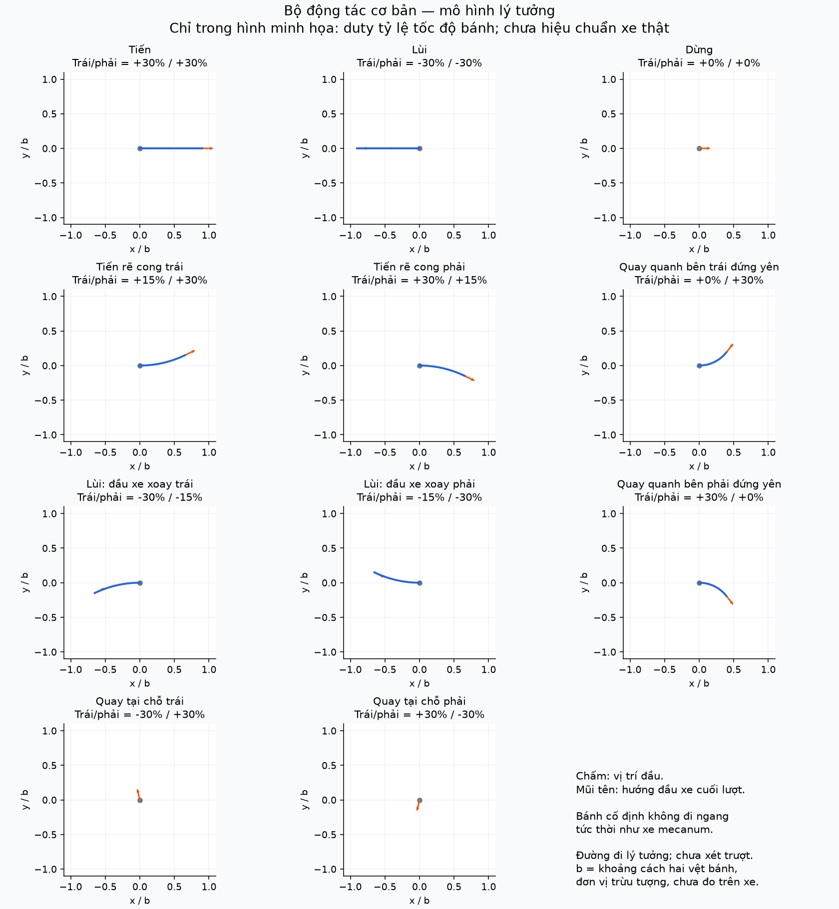
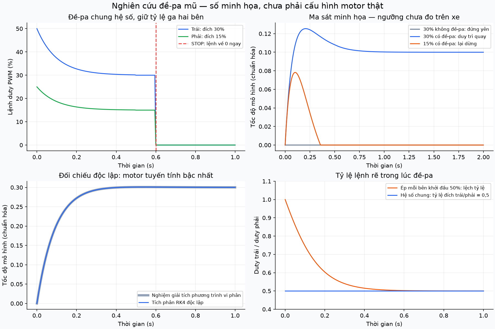
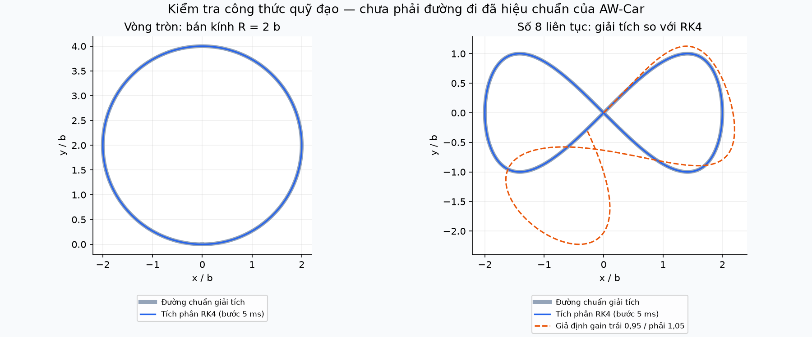

# Động tác cơ bản và đề-pa mũ — nghiên cứu Python/matplotlib

Ngày 12/11/2026. Nền đối chiếu: prototype-v2 `85a0094`.
Phạm vi: tính toán, mô phỏng và đề xuất bước nâng cấp nhỏ; **không sửa/nạp
firmware ba board, không sửa schematic tay, không bật PID**. MATLAB được bỏ
theo yêu cầu của chủ dự án. Kết quả có thể tái tạo bằng Python + matplotlib.

Đây là hồ sơ nghiên cứu tại commit47a2d81 trước khi sửa firmware. Chủ dự án đã
giao triển khai tiếp trên cùng nhánh; xem [hồ sơ triển khai](motion-primitives-implementation.md).
Các mô tả “hiện tại” về source bên dưới chỉ nền prototype-v2 trước nâng cấp.

## 1. Kết luận khả thi và giới hạn

Khả thi: đi thẳng/lùi, rẽ cong hai phía khi tiến/lùi, quay tại chỗ, quay quanh
một bên đứng yên; từ đó xây dựng đi vòng tròn và số 8. Không cần đổi lõi PWM
FPGA cho việc gửi hai duty độc lập. Phải bổ sung contract/lệnh ở Web/UART/Brain
nếu muốn gọi các động tác mới; firmware hiện chỉ có bốn hướng.

Xe TT 4WD bánh cố định là skid-steer, không có khả năng trượt ngang tức thời.
“Không góc chết” nên hiểu là phối hợp tiến/lùi/quay để đổi hướng trong không
gian đủ rộng, không phải đi ngang, tự tránh mọi vật cản hoặc tới mọi vị trí
trong mọi không gian hẹp. Mô hình differential-drive là xấp xỉ; thực tế rẽ
cần trượt ngang tại lốp, phụ thuộc sàn/tải và cơ khí.
[MathWorks mô tả giới hạn mô hình một trục lý tưởng](https://www.mathworks.com/help/robotics/ref/differentialdrivekinematics.html).
Nghiên cứu [Baril và cộng sự, 2020](https://arxiv.org/abs/2004.05131) so sánh
các mô hình skid-steer đã hiệu chỉnh trên hai loại mặt nền. Không dùng hệ số
của robot 590 kg trong nghiên cứu đó cho xe TT; nó chỉ là cơ sở để tránh coi
mô hình không trượt là chính xác sẵn cho mọi xe.

## 2. Source hiện tại đặt hành vi ở đâu?

| File từ root | Vai trò đã đọc |
| --- | --- |
| `esp/brain/main/car/tools.cc` | Đăng ký `self.car.move/stop/get_state`, mô tả tiếng Trung và schema cho Xiaozhi. MOVE chỉ `forward/backward/left/right`, mặc định 30%, 3 giây. Đây là tool chạy code, không phải file SKILL.md. |
| `esp/brain/main/car/runtime.cc` | Kiểm context hội thoại/generation, gửi yêu cầu UART; không chạy vòng điều khiển motor. |
| `esp/shared/src/control.cpp` | Chuyển bốn action thành duty trái/phải, STOP/timeout, đổi chiều 40 ms và đánh thức driver 1 ms. Chưa có mixer rẽ cong hay đề-pa. |
| `esp/motion/main/runtime.cpp` | Một task sở hữu điều khiển và SPI, đánh thức khi có lệnh, nền 5 ms; PID đang tắt. |
| `esp/shared/include/simple/protocol.hpp` | Action UART hiện chỉ bốn hướng + neutral; SPI đã có hai duty có dấu −1350…1350. |

Không chỉ đổi prompt để tuyên bố có skill mới. Một hành vi ghép phải có bộ
thực thi cục bộ và contract rõ. AI chỉ chọn hành vi/tham số một lần; Motion
thực hiện các bước. Các lệnh đơn hiện có giữ nguyên ý nghĩa đã nghiệm thu.

## 3. Bộ động tác nhỏ, không cần một enum cho mỗi quỹ đạo

Ba nhóm đủ dùng: **đi thẳng có dấu**, **cung có dấu**, **quay tại chỗ có dấu**;
STOP riêng. Quay quanh một bên là trường hợp đặc biệt của cung.

Quy ước tọa độ: x tiến, y trái, góc dương ngược chiều kim đồng hồ nhìn từ trên.
“Trái” trong bảng là đầu xe xoay sang trái, kể cả khi lùi. Nếu muốn nói
“đuôi xe lùi sang trái” thì phải đổi cách ánh xạ câu nói, không đảo nghĩa ngầm.

| Động tác minh họa | Duty trái | Duty phải |
| --- | ---: | ---: |
| Dừng | 0% | 0% |
| Tiến / lùi | +30% / −30% | +30% / −30% |
| Tiến rẽ trái | +15% | +30% |
| Tiến rẽ phải | +30% | +15% |
| Lùi, đầu xe xoay trái | −30% | −15% |
| Lùi, đầu xe xoay phải | −15% | −30% |
| Quay tại chỗ trái | −30% | +30% |
| Quay tại chỗ phải | +30% | −30% |
| Quay quanh bên trái đứng yên | 0% | +30% |
| Quay quanh bên phải đứng yên | +30% | 0% |

Duty không đồng nghĩa tốc độ/torque đo được. Bảng chỉ xác định dấu/tỷ lệ lệnh.

Mixer effort chuẩn hóa, ga `t` và rẽ `s` trong [−1,1]:

```text
rawL = t - s
rawR = t + s
scale = max(1, abs(rawL), abs(rawR))
uL = rawL / scale
uR = rawR / scale
```

Giới hạn chung giữ tỷ lệ lệnh khi bão hòa; kẹp từng bên riêng có thể đổi độ
cong mong muốn. Cách trộn này chưa bảo đảm tỷ lệ tốc độ bánh thật bằng tỷ lệ duty.

Khi đã hiệu chuẩn tốc độ hai bên, dùng động học:

```text
v = (vR + vL) / 2        omega = (vR - vL) / b
vL = v - b*omega/2       vR = v + b*omega/2
R = v/omega             (omega khác 0)
```

`b` là khoảng cách giữa tâm hai vệt bánh theo mô hình; không phải chiều dài
26 cm hoặc chiều rộng ngoài hai bánh. Với skid-steer còn cần hiệu chỉnh b
hiệu dụng. [WPILib dùng track width để chuyển v/omega thành tốc độ hai bên](https://docs.wpilib.org/en/stable/docs/software/kinematics-and-odometry/differential-drive-kinematics.html).



## 4. Đề-pa theo hàm mũ: được, nhưng không tự gán 100%

Profile đầu vào đề xuất cho một mục tiêu dương không đổi:

```text
u(t) = u_target + (u_start - u_target) * exp(-t/tau)
```

Ví dụ **chỉ cho mô phỏng**, target 30%, start 50%, tau=100 ms:

| Từ lúc bắt đầu xuất duty | Mũ chưa cắt | Envelope hữu hạn đề xuất |
| --- | ---: | ---: |
| 0 ms | 50,00% | 50,00% |
| 100 ms | 37,36% | 37,36% |
| 200 ms | 32,71% | 32,71% |
| 300 ms | 31,00% | 31,00% |
| 500 ms | 30,13% | chốt đúng 30,00% |

Sau 3*tau còn khoảng 5% phần boost; sau 5*tau còn 0,67% phần boost. Mô hình
envelope chốt về target tại 5*tau để không có đuôi vô hạn (bước nhỏ 0,135 điểm
phần trăm trong ví dụ này). `tau` phần mềm không tự động là hằng số cơ khí motor.
Khi target thay đổi trong lúc chạy, cập nhật trực tiếp theo lệnh mới, không
tự kích đề-pa lại hoặc hứa đường ga liên tục như profile cho target cố định.

Đề-pa không phải luôn tốt hơn tăng ga tuyến tính. Nó có thể tăng đáp ứng ban
đầu nhưng cũng tăng dòng và giật cơ khí. Chưa biết dòng khởi động/kẹt trục TT,
tải xe và nhiệt DRV nên **không chọn 100% hay 50% làm mặc định firmware**.
Phải đo mức bắt đầu quay và mức duy trì riêng từng bên/chiều, dòng nguồn và
điện áp tại driver. Không có phép đo dòng/torque/nhiệt trong mô phỏng này.

[Pololu Motoron có tham số starting speed, giới hạn gia tốc và trễ đổi chiều](https://www.pololu.com/docs/0J84/all):
đây là tham khảo việc vượt vùng ga không làm motor quay, không phải thuật toán
mũ được nhà sản xuất bảo chứng cho motor TT. [WPILib giải thích thành phần ma
sát kS, vận tốc kV và gia tốc kA](https://docs.wpilib.org/en/stable/docs/software/advanced-controls/introduction/introduction-to-feedforward.html).
Không lấy các hệ số của FRC làm hệ số AW-Car.

### Giữ tỷ lệ rẽ trong giai đoạn đề-pa

Không đặt cả hai bên lên cùng một mức sàn (ví dụ 50%) khi đích là L=15%,R=30%:
tỷ lệ lệnh sẽ từ 1:2 thành 1:1, ban đầu xe được yêu cầu đi thẳng.
Dùng một hệ số chung, có giới hạn:

```text
peak = max(abs(targetL), abs(targetR))
g0 = min(gain_boost, 1/peak)       # chỉ khi peak > 0
g(t) = 1 + (g0 - 1)*exp(-t/tau)
(uL,uR) = g(t)*(targetL,targetR)
```

Bên đứng yên vẫn bằng 0, chiều giữ nguyên, không vượt 100%, tỷ lệ lệnh giữ
nguyên. Tuy nhiên bên chậm của cung có thể vẫn chưa vượt ma sát. Không thể
vừa bảo đảm tỷ lệ **tốc độ thực** vừa không có thông tin phản hồi/hiệu chuẩn.

Mô hình ma sát phản ví dụ: ngưỡng bắt đầu 40%, ngưỡng duy trì 20%, đều tự đặt.
30% không kick đứng yên; kick 50% rồi về 30% duy trì chạy; kick 50% rồi về 15%
chạy một lúc rồi dừng. Đây là minh chứng logic, không phải dự đoán ngưỡng xe.
Ở thí nghiệm 15% dùng cùng peak 50% để cho thấy kể cả kick lớn hơn vẫn không
giải quyết được ga cuối dưới ngưỡng; nó khác ví dụ gain chung cố định 5/3.

### Không làm chậm flow đã nghiệm thu

- Profile chỉ xử lý tại Motion, không hỏi cloud mỗi bước, không delay/sleep.
- Mỗi tick 5 ms: cập nhật mục tiêu mới nhất, kiểm STOP/timeout trước, rồi
  envelope. STOP/nhả/mất lệnh/đổi mode về 0 ngay ở lệnh, không giảm mũ từ từ.
  Bánh vẫn có thể quay theo quán tính; 0 duty không phải chứng minh dừng cơ khí.
- Refresh Web 20 Hz không khởi động lại timer đề-pa; đổi tốc độ lúc đang chạy
  cũng không tự kick lại. Envelope offline đã có test cho các tình huống này.
- Đổi chiều vẫn giữ khoảng neutral 40 ms và wake ít nhất 1 ms của source cũ;
  chỉ bắt đầu timer boost khi được phép xuất duty. Không coi 40 ms là bằng
  chứng trục thật đã đứng yên. Lớp envelope không thay bộ phân xử này.
- Với bước cố định có thể dùng `z_next=z*exp(-dt/tau)`, tính hệ số một lần.
  Nếu task trễ, dùng thời gian đơn điệu thực hoặc hiệu chỉnh dt; không để
  profile kéo dài vì đếm số lần callback. Đây là đề xuất chưa đo trên ESP32.
- Chưa thêm lọc toàn bộ đầu vào hoặc S-curve cho mọi thao tác. [WPILib cảnh
  báo low-pass có thể thêm phase lag; slew limiter là lựa chọn khác](https://docs.wpilib.org/en/stable/docs/software/advanced-controls/filters/slew-rate-limiter.html).
  Chỉ thêm giới hạn gia tốc khi có phép đo chứng minh cần; không xếp nhiều
  bộ lọc làm mất đáp ứng nhấn/nhả hiện có.



### Tụ của quạt AC có thay đề-pa PWM được không?

Không áp dụng trực tiếp. Với motor quạt AC một pha kiểu dùng tụ, tụ nối với
cuộn phụ để tạo lệch pha/từ trường quay; nhiều quạt dùng tụ ngậm khi vận hành,
không chỉ tụ đề được ngắt sau khởi động. [Oriental Motor giải thích cơ chế
tụ của motor AC một pha](https://faq.orientalmotor.com/why-do-single-phase-ac-motors-need-capacitors).
Motor TT DC chổi than không có cặp cuộn chính/phụ theo cơ chế đó. Không thêm
tụ AC nối tiếp motor TT để mong tạo mô-men khởi động tương tự.

Hai vai trò tụ có ích cho xe là **tụ nguồn VM–GND sát driver** hỗ trợ dòng
quá độ/giảm biến động nguồn, và **tụ gốm nhỏ sát cực motor** để giảm nhiễu
chổi than. Chúng không tự tăng áp VM hoặc sửa được nguồn yếu/tải quá lớn.
[TI hướng dẫn chọn bulk capacitance theo dòng tải, nguồn và sụt áp cho phép](https://www.ti.com/lit/ds/symlink/drv8833.pdf);
[Pololu hướng dẫn tụ chống nhiễu motor chổi than](https://www.pololu.com/docs/0J15/9).
Đây là hai chức năng khác nhau, không lấy tụ hóa lớn mắc ngang AO/BO: đầu ra
cầu H đảo cực khi tiến/lùi, không phù hợp tụ hóa phân cực thông thường.

Ước lượng lý tưởng nếu tụ phải tự bù toàn bộ dòng thiếu:

```text
C >= delta_I * delta_t / delta_V
Ví dụ delta_I=1 A, delta_t=0,1 s, delta_V=0,5 V:
C >= 0,2 F = 200.000 uF
Tụ 470 uF với cùng delta_I/delta_V chỉ bù khoảng 0,235 ms.
```

Chưa tính ESR, dây, điện cảm, điện áp định mức và nguồn tiếp tục cấp dòng.
Các số là phép tính ví dụ, không phải dòng motor đã đo hoặc giá trị tụ chốt
cho xe. Vì vậy tụ nguồn hỗ trợ quá độ ngắn; đề-pa chủ yếu vẫn cần nguồn đủ
dòng + PWM phù hợp, sau đó đo trên cơ khí thật.

## 5. Cách chứng minh và số đo mô phỏng

Không so sánh hai bản chép của cùng một công thức cập nhật:

1. Lưới ga/rẽ 81×81: kiểm giới hạn chung, tỷ lệ và chuyển ngược v/omega.
2. Tích phân ODE RK4 độc lập từ tốc độ hai bánh; đối chiếu đường tròn giải
   tích x=2*sin(0.2t), y=2*(1−cos(0.2t)).
3. Số 8 Gerono x=2*sin(s), y=sin(2s), s=0.2t: suy v/omega từ đạo hàm,
   tích phân lại trạng thái và so với tọa độ chuẩn. Đạo hàm không triệt tiêu
   đồng thời nên không có điểm kỳ dị hướng trên ví dụ này.
4. Giảm bước RK4 100→50 ms để kiểm hội tụ ở vùng sai số không bị roundoff
   chi phối. 5→2,5 ms có kết quả riêng, không suy bậc hội tụ từ số gần epsilon.
5. Motor tuyến tính tau_m*dv/dt+v=u(t): RK4 so nghiệm giải tích có đầu vào
   mũ; kiểm cả tau_m=tau_input. Mô hình này không có ma sát, độc lập với mô
   hình ma sát từng đoạn ở trên.
6. Phản ví dụ sai lệch gain hai bên 0,95/1,05: vẫn gửi quỹ đạo số 8 cũ để
   xem đường thực trong mô hình lệch khỏi đường chuẩn. Không coi 5% là độ
   lệch đo được trên AW-Car, không coi đây là mô hình trượt đầy đủ.

Tất cả b=1 **đơn vị chiều dài trừu tượng**, thời gian giây. Không đổi sang mm
hoặc độ chính xác xe khi chưa đo b/tốc độ. Chu kỳ tròn/số 8 minh họa 31,416 s,
không được gửi như lệnh AI đơn vượt cap 3 giây hiện tại. Nếu triển skill sau
này phải có runner hữu hạn, giới hạn tổng thời gian và STOP hủy cả chuỗi;
không đơn giản bỏ cap hoặc nối lệnh cloud vô hạn.

| Đối chiếu thực chạy Python 3.13.15 | Kết quả |
| --- | ---: |
| Mixer | 6.561 tổ hợp; sai số lớn nhất 2,23e−16 |
| Tròn RK4 5 ms so giải tích | max vị trí 5,55e−13 b |
| Số 8 RK4 5 ms so giải tích | max vị trí 2,84e−13 b |
| Số 8 RK4 2,5 ms so giải tích | max vị trí 2,60e−14 b |
| Số 8 Euler 5 ms so giải tích | max vị trí 0,003787 b |
| Motor tuyến tính: RK4 so nghiệm đóng | max 2,33e−9 tốc độ chuẩn hóa |
| Motor tuyến tính, hai tau bằng nhau | max 1,18e−8 tốc độ chuẩn hóa |
| Recurrence mũ 1.001 bước so exp trực tiếp | max 1,67e−16 |
| Gain hai bên tự đặt 0,95/1,05 | số 8 lệch max 2,112 b; cuối lệch 0,405 b |

Sai số rất nhỏ ở hàng RK4 là sai số **giữa hai cách tính trong cùng mô hình
lý tưởng**, không phải sai số vị trí thật. Ngược lại phản ví dụ gain cho thấy
chưa thể hứa vòng tròn/số 8 chính xác chỉ từ thời gian và duty.
RK4 chỉ dùng trên PC để kiểm công thức, không đề xuất đưa solver này vào task
điều khiển ESP32. File JSON/CSV giữ các số đầy đủ để đối chiếu, hình không thay test.



## 6. Khuyến nghị triển khai theo mốc nhỏ

1. Giữ bốn hướng/STOP đã nghiệm thu. Thêm mixer độc lập và cung/pivot ở Motion;
   khóa dấu theo bảng, mở rộng lệnh theo phiên bản rõ, kiểm hồi quy Web/UART/AI.
   Chưa đổi SPI/RTL, timeout hay thời lượng AI mặc định 3 giây.
2. Lắp/đo motor trên giá kê, nguồn bàn giới hạn dòng. Đo dòng khởi động/kẹt
   theo phương pháp phù hợp và ngưỡng bắt đầu/duy trì; không thử kẹt kéo dài.
   Dữ liệu này quyết định có dùng kick, peak và tau; không dùng số minh họa làm mặc định.
3. Nếu cần, bật envelope có cấu hình, mặc định tắt. A/B có/không kick ở cùng
   ga/tải/nguồn; đo trễ bắt đầu quay, dòng đỉnh, sụt nguồn và giữ STOP tức thời.
4. Khi đủ hai encoder gắn trục/đĩa và hiệu chuẩn: đo tốc độ, PID hai bên;
   một OUT vẫn không xác nhận chiều thực. IMU có thể hỗ trợ góc nhưng phải
   đo bias và hiệu chỉnh. Không bật PID/odometry giả với một encoder hiện có.
5. Sau khi tốc độ/góc đáng tin mới nghiệm thu skill vòng tròn/số 8. Tự hành
   tránh vật cản và mép rơi là mốc riêng, cần cảm biến thật; mô phỏng này không làm được việc đó.

Tối giản đề xuất: **mixer + envelope tùy chọn** ở Motion; Brain vẫn gọi tool,
FPGA vẫn PWM/encoder. Chưa thêm planner, MPC, SLAM hoặc framework mới.

## 7. Tái tạo kết quả

Từ root worktree nghiên cứu, PowerShell:

```powershell
python -m venv --system-site-packages build/sim-venv
& build/sim-venv/Scripts/python.exe -m pip install -r utils/requirements-motion-sim.txt
& build/sim-venv/Scripts/python.exe utils/motion_primitives_sim.py
python -m unittest discover -s test -p test_motion_primitives_sim.py -v
python utils/check_repo.py
python -m unittest discover -s test
git diff --check
```

Để chỉ tính số bằng Python chuẩn, không cần cài plotting:

```powershell
python utils/motion_primitives_sim.py --no-plots --output build/motion-study-noplots
```

Đầu ra đã lọc: `data/motion-simulation/`. Build/venv không vào Git. Không có
lệnh mở COM, OTA, JTAG, ARM hay thay firmware trong công cụ mô phỏng này.

Lượt kiểm tra tại worktree nghiên cứu: cấu trúc PASS, 20 test mô phỏng PASS;
toàn bộ discovery 48 test, 1 skip browser opt-in. Native core cũ vẫn qua
52.301 assertion và Brain qua 127 context check. `git diff --check` đạt.
Không chạy lại build/nạp ESP32 hoặc Gowin vì source `esp/` và `fpga/` giữ
nguyên nền prototype-v2; kiểm thử này không bổ sung nghiệm thu phần cứng.
