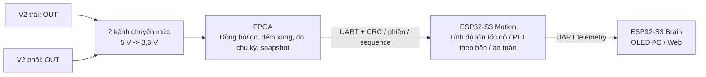

# Tích hợp bộ đọc một OUT cho TT 4WD

Ngày 28/10/2026, chủ dự án ưu tiên giảm chi phí, chấp nhận **chỉ đo độ lớn
tốc độ** bằng bộ đọc hồng ngoại V2 một OUT. Hiện đã thêm **RTL FPGA và mô phỏng
cho 2 OUT + UART v2**; xem
[wire v2](../firmware/shared/fpga-protocol-v2.md). Đây **chưa phải tích hợp
firmware Motion hay kiểm thử board/thực tế**.

## 1. Phần cứng và đường dữ liệu

**Chọn bank trước chọn điện áp:** theo sơ đồ Tang Nano 9K (3672), BANK0/1/2
dùng VCCO=3,3 V, còn BANK3 dùng 1,8 V. Không phải mọi GPIO của Nano 9K là
1,8 V hoặc mọi GPIO là 3,3 V. Phương án AW-Car ưu tiên đặt encoder, UART
Motion và GPIO an toàn/driver ở các chân I/O 3,3 V còn phù hợp, cấu hình
LVCMOS33 theo bank thực. Do đó đường encoder cần **5 V -> 3,3 V**, chưa cần
thêm bước 3,3 V -> 1,8 V. Nếu bắt buộc dùng bank 1,8 V thì phải thiết kế
chuyển mức theo chiều tín hiệu và ngưỡng hai đầu riêng, không nối 3,3/5 V
vào bank đó. CST không tự thay điện áp rail của board. Pinout/revision board
thực chưa chốt; không gán số chân hay kết luận fit/timing từ lựa chọn bank.

- Dự kiến **2 bộ đọc V2**, một đĩa/bánh đại diện bên trái, một bên phải.
  Giữ nguyên motor, khung TT 4WD, hai nhóm PWM/chiều và hai DRV8833 dự kiến.
  Hai bánh được đo không đại diện đầy đủ mọi lỗi riêng của bốn motor.
- Theo ảnh shop, V2 dùng nguồn 5 V, có một OUT TTL. OUT đi qua mạch chuyển
  mức số **5 V -> 3,3 V**, rồi vào FPGA; không nối 5 V trực tiếp vào GPIO.
  MCU/FPGA/cảm biến cần chung tham chiếu GND, đi dây tránh đường dòng motor.
- Theo yêu cầu phổ biến/rẻ, ứng viên mua hiện tại là **module MOSFET 4 kênh
  hai chiều 3,3 V/5 V, có HV/LV/GND**, dùng hai kênh. Mẫu đối chiếu Hshop
  HS0666V đang niêm yết 10.000đ ngày 28/10/2026, chưa ship/chưa xác nhận mua.
  Nhà bán không nêu mã MOSFET; BSS138 từ SparkFun/Adafruit là nguyên lý tham
  chiếu, không phải xác nhận chính xác linh kiện HS0666V.
- Với module chuẩn đó: HV=5 V, LV=3,3 V, GND chung; OUT trái/phải đi vào
  HV1/HV2, LV1/LV2 đi vào các input FPGA bank 3,3 V. Đối chiếu nhãn pin,
  pull-up/mạch ra và điện áp thực; thử cạnh/số xung/tải/dây tại tốc độ motor
  lớn nhất, kể cả nhiễu motor. Không chỉ nhìn điện áp danh nghĩa rồi coi đã
  nghiệm thu. BSS138/pull-up chậm hơn buffer chủ động; không mặc định dùng
  module này cho mọi đường tốc độ cao, PWM driver hoặc mạch E-stop/gate.
- SN74LVC125A cấp 3,3 V vẫn là buffer thay thế khi cần, nhưng không bắt buộc
  mua IC SMD khó đấu cho nguyên mẫu này. TXS0108E chưa được chọn chỉ vì có
  tám kênh; đối chiếu khác biệt/ngưỡng trong bảng linh kiện.



Cảm biến không có giao thức UART/I²C/SPI; nó xuất mức HIGH/LOW theo đĩa.
Giao thức UART nằm ở chặng FPGA–Motion, nên có thể giữ phân tải hiện tại.
FPGA mục tiêu vẫn Tang Nano 9K; còn phải fit/timing đúng chip và thử mạch thực.

## 2. Cần thay gì trong RTL

RTL quadrature X4 v1 vẫn được giữ để regression. Đã thêm chế độ đếm xung đơn
trong `drive_core_single_out.sv` và các module pulse mới; hiện kiểm thử mô phỏng:

1. Đồng bộ/lọc từng OUT; mẫu đầu sau reset chỉ lập mốc, không tạo xung giả
   khi đầu vào khởi động HIGH. Chỉ đếm **một cạnh lên sau lọc mỗi chu kỳ**.
2. Hai bộ đếm uint32 tăng đơn điệu, wrap modulo 2^32; không tăng/giảm theo
   chiều lệnh motor và không giả tạo pha B bằng delay hoặc sao chép OUT.
3. Đo chu kỳ giữa hai cạnh đã nhận và tuổi cạnh cuối. Cần ít nhất hai cạnh
   để có period hợp lệ; xử lý reset, timeout/overflow và input đứng HIGH/LOW.
4. Snapshot hai bộ đếm, chu kỳ/tuổi xung và trạng thái phải nguyên tử. Giữ
   timestamp/sequence và watchdog/ARM/gate độc lập việc motor có xung hay không.
5. Wrapper dành một input tín hiệu cho mỗi bộ đọc; không để input thừa nổi.
   Không giảm độ rộng hoặc bỏ an toàn chỉ để giảm chi phí cảm biến.

Một OUT **không biết chiều quay thực**. Cần báo rõ mode này; đẩy xe ngược,
trôi lùi hoặc motor quay sai cực vẫn có thể sinh số đếm tăng. Chỉ tiến theo
chính sách điều khiển không biến cảm biến thành bộ đo chiều. Không dùng số
đếm này để chứng nhận chống trôi lùi hoặc odometry có dấu. Điều kiện dừng do
mất lệnh/lỗi nguồn/E-stop vẫn giữ nguyên, không phụ thuộc bộ đọc một OUT.

## 3. Giao thức v2 đã triển khai ở FPGA, không dùng nhầm ngữ nghĩa v1

UART 115200 8N1/3,3 V, framing A5 5A, CRC16, session, sequence và CMD hai
duty/chiều có thể giữ cấu trúc. **Count xung đơn không cùng ý nghĩa count
quadrature X4 có dấu**; không nói firmware v1 có thể dùng nguyên mà không sửa.

Đã triển khai **phần FPGA của protocol v2** (version byte 02), parser loại
v1 và serializer STATUS 34 byte payload/47 byte frame với count/period/age
hai bên; bảng offset và ý nghĩa bit ở
[đặc tả v2](../firmware/shared/fpga-protocol-v2.md). **Firmware Motion v2
vẫn chưa có** và v1 không được coi là tương thích.

18 byte đầu vẫn giữ offset, nhưng STATUS v2 định nghĩa lại status byte và
thêm 4 field uint32: period trái/phải, age trái/phải. Payload là 34 byte,
toàn frame 47 byte. Tại 100 Hz/115200 8N1, TX chiếm 47.000 bit/s,
~4,08 ms/frame. Đã có test parser/serializer v2; chưa đo UART thật,
baud lệch/ARM/stale-data với firmware Motion.

Giữ file vector/reference v1 và hồi quy cũ; v2 có golden vector riêng
`firmware/shared/fpga-vectors-v2.hex`, đối chiếu serializer bằng reference Python.
Từ 02/11/2026 hai phần đã gom vào `feat/f01-fpga-drive`; mặc định một OUT/v2,
lùi và quay tại chỗ bật, zero40ms/setup1us, adapter DRV8833 đã nối.
Cấu hình một OUT/v1 cũ vẫn có khi chọn tường minh, không có period/age.
Motion phải xác nhận phiên bản/mode, từ chối mode không hỗ trợ và biết rõ
direction-known=false. Count delta dùng modulo uint32 và xung/vòng hiệu
chuẩn riêng; không lấy tick/vòng X4 cũ chia cho xung đơn.

## 4. Cách tính tốc độ và độ phân giải

Gọi D là đường kính lăn thực (m), N là số cạnh được đếm trên một vòng bánh:

```text
speed_magnitude = delta_count * pi * D / (N * delta_time_s)
speed_kmh = 3.6 * speed_magnitude
speed_from_period = pi * D * clock_hz / (N * period_ticks)
```

Nếu đĩa thực có 20 khe và đếm một cạnh/khe, N có thể là 20 sau hiệu chuẩn;
không mặc định 80 như X4. Với D=60 mm và N=20 giả định, mỗi xung tương ứng
khoảng 9,42 mm. Đếm trong cửa sổ 10 ms cho bước tốc độ khoảng 0,94 m/s,
quá thô để mặc định PID tốc độ thấp mượt. Snapshot vẫn có thể 10 ms, nhưng
ước lượng nên dùng period lúc ít xung, cửa sổ/lọc phù hợp khi nhiều xung.
Không hứa tăng tần số PID sẽ tăng độ phân giải cơ của đĩa.

Tuổi xung/timeout cần phân biệt đứng yên, mất dây và kẹt theo setpoint, dòng,
thời gian; không có xung chưa chứng minh motor bị kẹt. Không giữ speed cũ
mãi khi motor dừng, cũng không ép speed=0 mỗi snapshot chưa có xung mới.
Lọc/timeout tăng độ trễ nên phải đo lại điều kiện PID/quãng dừng thực tế.

## 5. Thứ tự chốt và kiểm tra

1. Giữ hai V2 làm ứng viên mua, kiểm tra khe/gá với đĩa TT và mức OUT thực;
   chọn mạch chuyển mức đúng, chưa đánh dấu đã mua từ ảnh sản phẩm.
2. Đã bổ sung RTL xung đơn và protocol v2 trên nhánh
   `feat/f04-single-out-encoder`; còn phải chốt pin wrapper đúng board.
3. Test cạnh/khởi tạo HIGH/LOW, nhiễu/ngưỡng lọc, đứng yên/mất dây, hai tốc
   độ khác nhau, wrap, period/age validity và snapshot nguyên tử.
4. Test vector/status v2, parser loại v1/v2 sai mode, CRC/phiên/sequence,
   boot/reset/ARM/deadline/stale data; chạy lại regression và synthesis.
5. Kiểm tra fit/timing Nano 9K, đo điện áp/xung, thử motor nâng bánh và đo
   dòng/nhiệt/gate. Chưa nghiệm thu xe hoặc bốn bánh độc lập từ test logic.

Nguồn: [Microchip AN2434 về một kênh và A/B](https://onlinedocs.microchip.com/oxy/GUID-954122A4-C243-4CDD-AAB7-64D199581D04-en-US-5/GUID-96E15BCB-15F0-4DC6-876D-66EBF4B40CC7.html),
[TI SN74LVC125A](https://www.ti.com/product/SN74LVC125A),
[Hshop HS0666V, module đang đánh giá](https://hshop.vn/mach-chuyen-muc-tin-hieu-logic-4-kenh),
[SparkFun mạch MOSFET HV/LV](https://www.sparkfun.com/sparkfun-logic-level-converter-bi-directional.html),
[Adafruit BSS138 với tín hiệu tốc độ thấp](https://www.adafruit.com/product/757),
[Sipeed: sơ đồ Nano 9K, các rail VCCO](https://dl.sipeed.com/fileList/TANG/Nano%209K/2_Schematic/Tang_Nano_9k_3672_Schematic.pdf),
[kiểm kê và ảnh thông số V2 do chủ dự án cung cấp](../hardware/components.md),
[protocol v1 hiện có](../firmware/shared/fpga-protocol.md).
