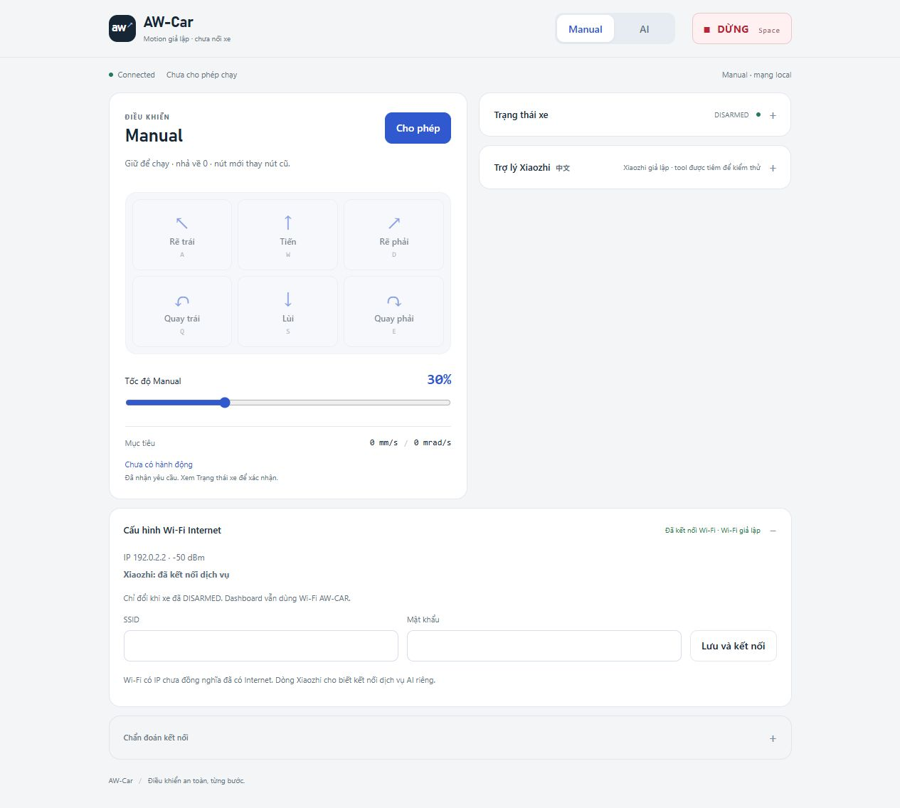

# WS2812 báo trạng thái Brain và Motion

Theo yêu cầu chủ dự án, WS2812 onboard thay vai trò demo AI điều khiển đèn.
Đã xóa tool self.rgb_light, handler RGB ở Brain/simulator và các nút/chọn màu
trong HTML/JS/CSS. Không có handler tương thích hoặc tool ép màu mới.
Giữ tên build profile aw-car-ai-rgb; giữ mic/OLED/loa/BOOT và self.car tools.

## Màu và phạm vi

| Board | Đỏ ưu tiên cao nhất | Xanh dương | Xanh lá |
| --- | --- | --- | --- |
| Brain | Motion fault/stateFAULT; STATUS đã có nhưng age≥150ms | Chưa STA cóIP; chưa STATUS; AI mode chưa có cloud session | STA cóIP, STATUS mới và không lỗi đang theo dõi; AI mode có session |
| Motion | Fault Motion/FPGA safety hoặc critical diagnostic0x8800; heartbeat control quá20ms | LOCKED/chưa validated; chờ FPGA; safety/gate chưa sẵn sàng | Cấu hình/FPGA/safety/gate cục bộ hợp lệ, không fault |

Boot xanh dương. Lỗi thắng mất Wi-Fi hoặc chờ kết nối. Cảnh báo FPGA ngoài
mask0x88ff không tự bật đỏ. CRC/RX error lịch sử đơn lẻ không giữ đỏ vĩnh
viễn; deadline và fault đã có vẫn là nguồn quyết định. User STOP, DISARMED,
AI đang ngủ ở Manual hoặc Web chưa mở không tự trở thành lỗi.

Brain xanh lá chỉ xác nhận các điều kiện của Brain; không đại diện cho Motion
đã validated hoặc motor đã ARM. Motion bản đang thử vẫn LOCKED/không FPGA,
nên xanh dương là đúng. Motion không khởi tạo Wi-Fi để chạy đèn; điều kiện
xanh dương của board này là chờ cục bộ. Khi DISARMED không có yêu cầu lệnh,
đèn không chứng minh đầu bên kia đã nhận UART hoặc nguồn công suất khỏe.
STA cóIP cũng chưa chứng minh mọi dịch vụ Internet đều truy cập được.

## Luồng ít tải

`status_indicator.h` chung hai nhánh, không allocation, GPIO, log hoặc RTOS.
Brain đọc snapshot core và atomic Connected mỗi50ms ở task status sẵn có,
ngoài HTTP server/control/UART. Motion dùng StatsTask100ms, đọc snapshot,
GPIO và heartbeat sẵn có; không thêm task, scan, UART ping hay timer ISR.
Các vòng control giữ priority/deadline cũ và không gọi driver LED.

Một writer mỗi pixel, RMT1LED, độ sáng12/255. Cache chỉ refresh khi màu đổi;
reason đổi cùng màu không cần ghi. LED write thất bại chỉ retry sau1s, không
reset firmware, bỏ fail-safe hay tăng quyền. Task đọc metadata dùng snapshot/
mutex ngắn; không giữ mutex core trong lúc chờ RMT. Không ghi flash định kỳ.

Brain GPIO48 đã dùng thành công ở demo trước. Motion có
`AWCAR_STATUS_LED_GPIO=48` mặc định, kiểm xung đột pin với UART/gate/strap.
Phải quan sát LED trên đúng revision Motion; nếu revision dùng chân khác,
đổi Kconfig rồi build, không tự thử nhiều GPIO đang có ngoại vi.

## Chẩn đoán và kiểm thử

Brain STATUS có `indicator` chỉ đọc; dashboard hiện trong chẩn đoán.
Motion console `status` có cùng thông tin color/reason/known/writes/errors/
write_max_us. Known là kết quả ghi driver, không đo màu bằng cảm biến.
write_max_us là thời gian gọi driver LED, không phải latency điều khiển xe.

Host test dùng cùng policy C++: boundary149/150ms, lỗi thắng waiting, AI/
Manual, LOCKED/FPGA/gate, từng bit fault/diagnostic; 100.000 lần kiểm cùng
màu chỉ1write, reason đổi không refresh và retry deadline đúng1s. Web test
xác minh UI RGB đã xóa và command không còn được nhận, chat vẫn hoạt động.
Simulator gọi chính policy C++ qua host library. Build, thử browser và số đo
board phải được ghi riêng trước khi gọi là nghiệm thu màu vật lý.

Phép reset Motion khi DISARMED đã tìm ra lỗi phục hồi cũ: UART vẫn nhận
frame CRC hợp lệ, nhưng sequence sau reboot bị cửa sổ trước reset từ chối.
Hai ca host mới tái hiện thất bại trước sửa. Brain nay xử lý STATUS stale
một lần cho cả DISARMED, đổi epoch và gửi STOP; sequence được đồng bộ lại
sau thu quyền. Khi dữ liệu còn mới vẫn giữ kiểm session/sequence cũ; ARM
luôn cần yêu cầu mới và HELLO/ACK mới. Không tự ARM hoặc flood STOP khi peer
tiếp tục vắng. `Tick` hết hạn trước bước admission STATUS tại boundary.

Mục cấu hình Wi-Fi trên Dashboard có badge trạng thái ngay cả khi đóng mục,
chi tiết IP/RSSI, đang association/DHCP, lý do thất bại và đếm lùi retry.
Xiaozhi có dòng kết nối dịch vụ riêng; STA cóIP không được coi là đã có WAN/
cloud. Khi STATUS Dashboard cũ/mất socket, bỏ nhãn mạng xanh cũ và hiện chưa
có dữ liệu mới. Lưu chỉ báo Brain nhận cấu hình, không báo nối thành công.

Log cấu hình cho thấy mạng vừa chọn đã có ở index1; AddSsid của dependency
cập nhật tại chỗ nên lần boot sau vẫn chọn index0 cũ. Worker nay gọi helper
RememberSelectedWifi để lưu mạng đã chọn làm mặc định, chỉ khi cấu hình do
người dùng yêu cầu. Không sửa managed_components hoặc thêm ghi NVS định kỳ.
Test mô phỏng API lưu/khởi động lại, bảo toàn mạng khác và tránh promote/ghi
thêm khi mạng đã ở đầu danh sách. Cần lưu mạng đúng một lần sau bản sửa.

LED chỉ là chẩn đoán: CPU treo có thể giữ màu cũ, và LED không thể tự phát
hiện mọi bug, sụt nguồn hoặc đứt dây. Watchdog/STOP/khóa driver độc lập giữ
nguyên; không dùng màu xanh thay các điều kiện ARM.

Nhãn Web chỉ cập nhật DOM khi nội dung đổi, tránh lặp thông báo aria-live ở10Hz.
Khi STOP ban đầu bị mất vì peer đang trong ROM/UART init, STATUS đầu tiên
sau discovery kích một STOP xác nhận nữa. Không thử liên tục khi peer vắng;
ACK mới vẫn bắt buộc trước một yêu cầu ARM mới. Hai ca hồi quy kiểm mất
STOP tại boot và tại reset, rồi xác nhận chỉ ARM tường minh mới chạy.

## Kết quả chốt 05/11/2026

96 root tests Brain, 72 root tests Motion, 9 test JavaScript và ghép hai
core C++ thật đều đạt; hai firmware build ESP-IDF6.1 và nạp tại0x0000.
NVS hai board và motioncfg được đọc mới trước nạp, đối chiếu byte sau nạp
không đổi. Bộ khôi phục cục bộ hiện trỏ bản này, không chứa trong Git.

Lượt cuối65s không reset/nạp: 1.202 STATUS trong60,12s (~19,99Hz), tuổi
dữ liệu≤45ms, parser/HW errors0. Motion LOCKED, hai permit LOW, WS2812
xanh dương, writes1→1/errors0/max471µs; heap free350.316byte không đổi
trong7mẫu. Lượt này không có Dashboard client; không coi là WS soak.
Lượt120s trước đó có Dashboard giữ kết nối, không tăng closed/send/queue
failure. Phép cố ý nạp lại Motion làm Brain đỏ khi mất STATUS rồi về xanh
dương khi phục hồi trong lúc STA offline; không tự ARM.

Sau reboot cuối, STA tự kết nối bằng cấu hình đã lưu ở lần thử2: lần đầu
reason202, đợi cooldown xác thực rồi thành online/IP hợp lệ. Đây là lỗi
xác thực được báo từ driver, không đủ kết luận người dùng nhập sai mật khẩu.
Người dùng xác nhận Dashboard hiện riêng Wi-Fi/Xiaozhi đã kết nối và AI
nghe/trả lời trong khi WS2812 Brain vẫn xanh lá. Chưa có soak Wi-Fi/audio
30phút mới, không đổi kết luận về lỗi1006 cũ hoặc loa rè/nguồn chưa đo.

Chi tiết/hash source và binary ở [báo cáo đã lọc](status-led-report.json).
Ảnh phía trên là browser giả lập dùng core/policy production, không phải
ảnh chụp Dashboard từ ESP32. Stock profile không build lại trong lượt này.
