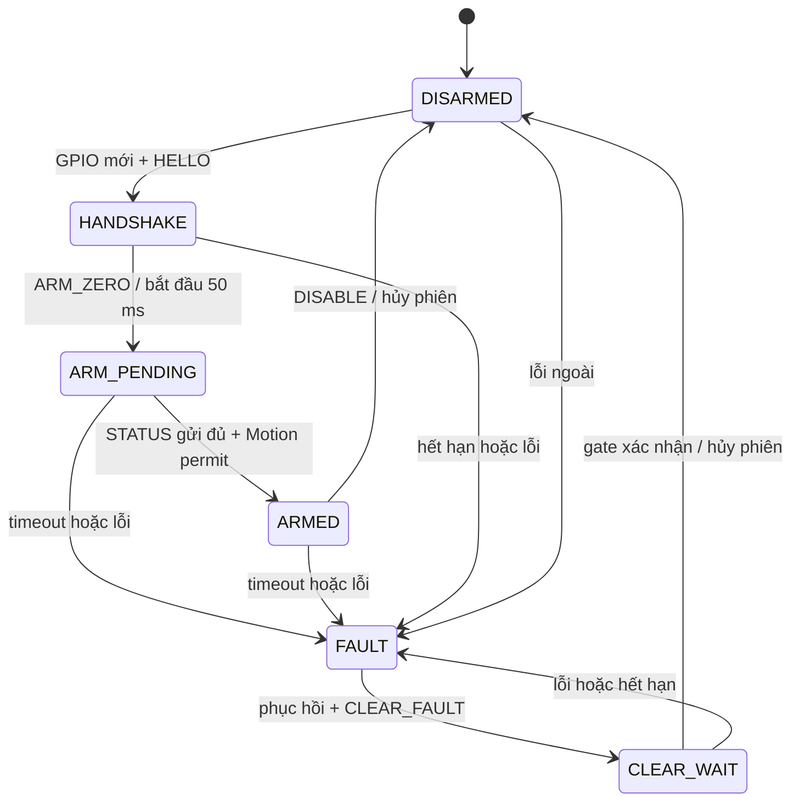

# Hợp đồng an toàn Motion–FPGA

RTL tương ứng: `safety_fsm.sv` và top logic `drive_core.sv`. Wire format v1
giữ nguyên; tài liệu này chốt GPIO phục hồi, mã STATUS và trách nhiệm hai đầu.
Đã có mô hình kiểm thử, chưa có firmware Motion hoặc mạch gate thực tế.

## Tín hiệu ngoài UART

| Tín hiệu logic | Hướng | Vai trò |
| --- | --- | --- |
| motion_permit | Motion -> FPGA và gate | Mặc định LOW; đường khóa driver độc lập UART |
| recovery_req | Motion -> FPGA | Mặc định LOW; yêu cầu phục hồi mới, chỉ khi Motion permit LOW |
| recovery_ack | FPGA -> Motion | Xác nhận yêu cầu GPIO; sau ARM dùng để báo đã gửi xong STATUS ARM_PENDING |
| safety_ok | Mạch an toàn -> FPGA và gate | HIGH khi E-stop/nguồn hợp lệ; LOW khóa ngay độc lập clock |
| gate_fault_n | Chốt lỗi ngoài -> FPGA | HIGH khi chốt gate đã được clear; LOW giữ driver tắt |
| gate_clear | FPGA -> chốt ngoài | Yêu cầu clear; không thay quyền khóa trực tiếp của E-stop/Motion |
| fpga_permit | FPGA -> gate | HIGH chỉ trong ARMED với các điều kiện hợp lệ |

Các tín hiệu trên là mức logic, chưa phải pinout hay thiết kế điện. Gate ngoài
cho phép driver khi **cả hai permit, safety_ok và gate_fault_n đều HIGH**.
Pull-down/trạng thái khi chưa cấu hình phải giữ driver tắt. Chốt lỗi ngoài
ưu tiên SET khi E-stop/nguồn lỗi, kể cả lỗi ngắn hoặc FPGA mất clock. Chỉ
nhận clear khi lỗi vật lý đã hết và cả hai permit LOW; nhả nút/nguồn trở lại
không tự clear. Mô hình test khởi động với chốt lỗi LOW, cần clear chủ động.

`drive_core` capture LOW bất đồng bộ và nhả qua hai FF cho safety/gate/permit;
đồng bộ riêng recovery_req, đợi mẫu đầu hợp lệ trước khi xử lý. PWM/permit
còn được mask trực tiếp bởi reset và các điều kiện raw. Các đường mask/reset
này cần review recovery/removal, glitch và timing ở target; simulation không
chứng minh metastability. Reset ngoài phải thực sự assert khi cấp nguồn.

## Trình tự phục hồi và ARM

1. Motion khóa permit, ngừng PID phát lệnh, xóa hàng đợi TX/RX cũ. Sau reset
   phải quan sát FPGA ack LOW; FPGA cần quan sát req LOW và permit LOW sau
   khi input hợp lệ. GPIO HIGH còn sót lúc boot không mở cửa handshake.
2. Motion nâng req, đợi ack HIGH; FPGA hủy phiên và flush link. Motion hạ req,
   đợi ack LOW. Từ đây chỉ có một cửa nhận HELLO; req không phải quyền chạy.
3. Để UART yên ít nhất 5 ms rồi gửi HELLO với session mới khác zero và sequence
   khởi đầu. Chỉ HELLO trong cửa này mới cài phiên; HELLO khi chạy bị bỏ qua.
   Toàn cửa req/HELLO và bước HANDSHAKE có timeout 250 ms mặc định.
4. Khi không có FAULT: gửi ARM_ZERO với sequence mới. FPGA vào ARM_PENDING,
   PWM/permit vẫn LOW và **bắt đầu watchdog 50 ms ngay tại đây**.
5. FPGA gửi STATUS đúng session với state ARM_PENDING, đợi UART phát đủ stop
   bit CRC cuối rồi mới nâng ack. Motion phải nhận/kiểm tra CRC, session,
   snapshot mới và state ARM_PENDING, đồng thời thấy ack HIGH sau chuỗi ack
   HIGH->LOW của bước 2. Không nâng permit chỉ vì thấy một GPIO HIGH.
6. Motion mới nâng permit. FPGA vào ARMED, không reset watchdog ở cạnh này;
   duty vẫn zero cho đến CMD hợp lệ mới. CMD từ PID mới, không phát lại cache.
   Nếu permit lên trước xác nhận STATUS thì FPGA chốt FAULT.

Session32 không tự bảo đảm duy nhất sau reset hai đầu và không phải xác thực.
Motion phải tạo session mới, không tái dùng trong thời gian buffer có thể còn
dữ liệu cũ, flush buffer và thực hiện đủ GPIO/STATUS handshake. Firmware cần
kiểm thử lại hợp đồng này; mô hình hiện dùng session tăng cho từng phục hồi.
Đường GPIO riêng và permit bổ sung chân I/O so với phương án chỉ có UART.

Nếu đang FAULT: hoàn thành bước 1–3 để có phiên phục hồi, gửi CLEAR_FAULT với
sequence mới trong khi permit LOW và lỗi vật lý đã hết. FPGA giữ gate_clear
ít nhất 100 us, chờ gate_fault_n HIGH, tối đa 5 ms. Timeout/permit lên/req mới/
lỗi quay lại sẽ chốt FAULT. Thành công xóa lỗi, hủy phiên và về DISARMED;
**phải làm lại toàn bộ phục hồi rồi ARM**, không mở motor ngay sau clear.

## Watchdog và trạng thái

Mặc định 27 MHz: 1.350.000 tick = 50 ms. Nếu ARM được nhận ở t0 thì hết hạn
ở cạnh t0+N; CMD hợp lệ một tick trước hạn được nhận, CMD đúng cạnh hết hạn
bị loại. Chỉ CMD mới được guard chấp nhận **khi ARMED** gia hạn. HELLO,
ARM lặp, CLEAR, dữ liệu sai/duplicate/sai phiên và STATUS không gia hạn.
DISABLE hợp lệ giảm quyền dù sai phiên/sequence; hủy phiên và duty đang chờ.

| safety_state8 | Ý nghĩa |
| --- | --- |
| 0 | DISARMED |
| 1 | HANDSHAKE, đã cài phiên, chưa ARM |
| 2 | ARM_PENDING, watchdog đã chạy, đang chờ xác nhận |
| 3 | ARMED, có thể nhận CMD |
| 4 | FAULT, lỗi chốt |
| 5 | CLEAR_WAIT, đang yêu cầu clear chốt ngoài |

| Bit fault16 | Ý nghĩa |
| --- | --- |
| 0 | Watchdog hết hạn |
| 1 | E-stop/nguồn không hợp lệ hoặc chốt gate báo lỗi |
| 2 | Motion permit mất khi ARMED |
| 3 | Vi phạm phục hồi: req khi đang arm/chạy, permit quá sớm hoặc trong clear |
| 4 | PWM từ chối lệnh nội bộ, cần xem lỗi tích hợp |
| 5 | Gate không xác nhận clear trong hạn |
| 6 | Handshake hết hạn |
| 7 | Mã trạng thái FSM không hợp lệ |
| 8–15 | Dự phòng, hiện zero |

Lỗi có thể tích lũy; reset xóa FSM nhưng không được tự clear chốt phần cứng.
STATUS đóng băng state/fault lúc nhận snapshot, có thể cũ tới một chu kỳ mẫu
cộng thời gian UART. Không dùng STATUS thay đường E-stop/gate trực tiếp.
Tham số timer phải >=1; CLEAR_HOLD_CYCLES phải nhỏ hơn CLEAR_CYCLES. Đổi clock
phải đổi toàn bộ timer/PWM cùng lúc, không chỉ CLK_HZ.

## Khi FPGA mất clock hoặc Motion lỗi

Watchdog FPGA không đếm khi mất clock. Motion dùng đồng hồ riêng: từ mẫu mới
CRC đúng, đúng phiên cuối cùng, nếu quá 30 ms thì hạ permit trong 1 ms tiếp.
Sequence snapshot dùng delta modulo16 `0 < delta < 32768`; bản tin lặp/cũ/
đảo thứ tự không làm mới tuổi. Reset/session mới phải quay về quy trình ARM.
Mô hình test phát lại metadata snapshot cũ ngay cả khi clock FPGA đứng để
kiểm tra bộ giám sát Motion; chưa có firmware thực hiện chức năng này.

Trước ARM/PID, Motion phải xác nhận hai decoder đã khởi tạo (encoder_status
bit2/3), dữ liệu mới và encoder không báo lỗi cần dừng. Sticky invalid bit0/1
không tự trip FSM; Motion phải áp chính sách lỗi encoder và yêu cầu kiểm tra/
reset có kiểm soát, không bỏ qua rồi tiếp tục PID.

Lease Brain hết, PID/cảm biến lỗi phải làm Motion ngừng CMD và hạ permit;
không để tác vụ UART tự phát lại duty. GPIO permit tĩnh chưa chống mọi lỗi
treo MCU/lỗi chung: watchdog phần cứng ngoài còn phải xét theo thiết kế điện.
Driver disable có thể thả trôi; servo và quãng dừng phải thử riêng. Chưa có
adapter driver, sơ đồ gate, PCB, PnR/STA hoặc bằng chứng chạy motor thật.
