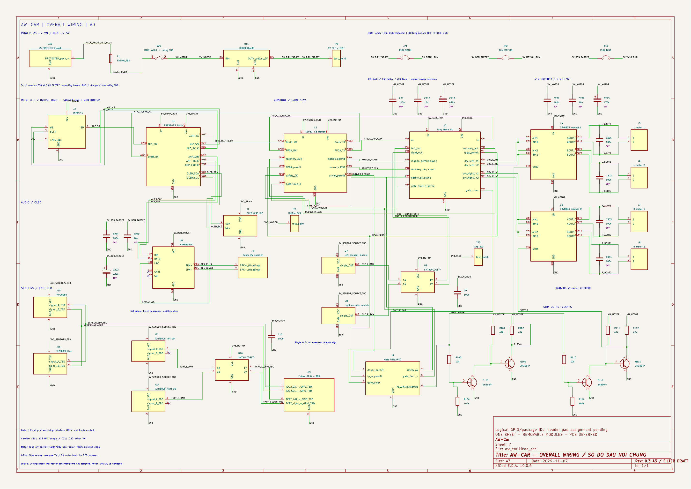

# Schematic và PCB AW-Car

Nhánh riêng **`feat/f04-pcb-schematic`** chứa source, ảnh xem, công cụ và
test KiCad. Bốn commit schematic trước đây được giữ nguyên; nhánh Tang
Nano9K đã tách về nền trước PCB, không phát triển schematic tại đó.

Mở **[aw_car.kicad_pro](aw_car.kicad_pro)** trong KiCad, rồi mở
**[aw_car.kicad_sch](aw_car.kicad_sch)**: sơ đồ đấu nối chung **một trang A3**,
60 phần tử,68 net. Brain, Motion, Tang, audio/OLED, hai driver/bốn
motor, encoder, cảm biến, nguồn và interface gate cùng nằm trên trang này.
Dây tín hiệu nối trực tiếp giữa các chân; các nhãn nguồn cùng tên nối chung.
Input bên trái, output bên phải, nguồn trên và GND dưới; chân hai chiều giữ
nhóm giao tiếp. Module dự kiến cắm rút, không hàn cố định lên carrier.



[Mở ảnh đầy đủ](../../docs/awcar-schematic-a3.png) ·
[Mở SVG để phóng to](../../docs/awcar-schematic-a3.svg).
Ảnh được xuất từ chính source KiCad đã kiểm thử; cập nhật ảnh khi đổi schematic.

Thư mục này giữ source KiCad: project, schematic, thư viện symbol cục bộ
`aw_car.kicad_sym`, `sym-lib-table` và model `generic-clamp.lib`. Đã bỏ các
sheet/project tách và hình/script PCB concept cũ khỏi thư mục theo yêu cầu
07/11/2026. Bản phục hồi gồm cả lịch sử chỉnh sửa cũ giữ cục bộ tại worktree
trước `tang-nano9k-target/AW-Car`, trong
`build/hardware-pcb-before-single-sheet-20261107/pcb` (Git ignore); không
đưa cache/lịch sử cục bộ đó vào nhánh PCB trên GitHub.

**Chưa tạo layout.** Khi schematic và thành phần được chốt, layout native
sẽ đặt ngay đây với tên `aw_car.kicad_pcb`; footprint/pad/outline
và Gerber chưa được duyệt. Đã gán ứng viên footprint0805/1206 cho8 tụ
và header1×2 bước2,54mm cho3 jumper. GPIO ESP32 và mã package Tang trên symbol là ID
logic để đối chiếu đấu dây, chưa phải số pad header của devboard/module.

Chủ dự án chọn **đặt xưởng làm bo, tự hàn, ưu tiên SMD; gate trên carrier**.
JP1–JP3 dùng header/cầu nối rút được **ở mặt sau**; thuộc tính schematic
ghi yêu cầu này, chờ đặt/lật footprint và kiểm khoảng hở ở layout.
[Linh kiện rời tận dụng](../../docs/awcar-passive-reuse.md): dành5 tụ100nF,
3 tụ10µF; định mức tụ chưa rõ nên chưa xác nhận đủ điều kiện lắp. Các
trở1kΩ/10Ω để dự phòng, không thay các giá trị tầng STBY hiện tại.

Nguồn trên xe:2S cấp VM driver trực tiếp; DSN6000AUD mục tiêu5,0V cấp amp
và ba board qua jumper riêng: JP1 Brain, JP2 Motion, JP3 Tang. **Đổi jumper
khi tắt nguồn. RUN: jumper lắp, USB tháo. DEBUG: mở jumper board tương ứng
trước khi cắm USB.** Chưa có cách ly tự động; không đóng jumper khi USB đang cắm.

Đã thêm9 tụ nguồn trên carrier và4 tụ100nF/50V không phân cực ngay hai cực
motor. C301–C304 được đánh dấu `exclude_from_board`, thuộc lắp ráp ngoài
carrier. Tụ bulk ứng viên:220µF/10V cho amp,470µF/25V cho mỗi driver; kèm
bypass100nF và decoupling10µF. Điện trở giữ ở tầng STBY; chưa thêm cuộn/ferrite
với dây loa/motor dự kiến<=20cm. Chi tiết và nguồn tham chiếu ở
[thiết kế lọc nguồn/jumper](../../docs/awcar-a3-filter-design.md).

Các phần còn mở trong [dữ liệu thiết kế](../../docs/awcar-schematic-design-inputs.json):
nguồn/USB trên board thực, BMS/sạc/cầu chì, GPIO cảm biến, header/footprint,
tải DSN và giá trị/ESR/ripple tụ. J9 là **khối giao tiếp chờ thay bằng gate
trên carrier**, chưa phải gate/E-stop/watchdog độc lập đầy đủ. Chưa nghiệm thu nguồn motor.

[Trình tự hoàn thiện schematic trước layout](../../docs/awcar-pcb-next-stage.md)
ghi rõ từng ref/net còn mở, thông số cần lấy từ module thực và các lựa chọn
đã chốt về gate/cách hàn/jumper; họ đầu nối dây còn mở. Tiếp tục tại worktree `aw-car-pcb`;
bản project trong worktree Tang cũ được giữ để đối chiếu chỉnh sửa trước đó.

Chủ dự án ưu tiên **giắc cắm/dây bấm sẵn** giống ảnh đã gửi.
Đế có vỏ nhựa **hàn trực tiếp lên carrier**, đầu giắc trên dây cắm/rút
vào đế này; cổng dây–bo đã được xác nhận, chưa chốt series/bước chân.
[Đề xuất mua giắc](../../docs/awcar-connector-selection.md) có số chân/số bộ
cho từng ngoại vi, ứng viên XH/VH/XT30 và yêu cầu đo bước chân trước gán pad.
Chưa chọn mã hàng cụ thể hoặc gán footprint đầu nối mới từ ảnh.

## Kiểm tra và mô phỏng

Chạy từ root, cần KiCad CLI trong PATH (máy hiện tại: `D:/APP/KiCad/bin`):

```sh
kicad-cli sch export netlist --format kicadxml -o build/awcar.xml hardware/pcb/aw_car.kicad_sch
python tools/check_awcar_schematic.py build/awcar.xml
kicad-cli sch erc --format json --severity-all --exit-code-violations -o build/awcar-erc.json hardware/pcb/aw_car.kicad_sch
python tools/simulate_awcar_clamps.py build/awcar.xml --output build/awcar-simulation
python -m unittest discover -s tests
```

Tạo `build` trước nếu chưa có. ERC bản A3: **0 error,0 warning**, không có
waiver mới. Nguồn đã được mô tả qua DSN và jumper, nhưng ERC không xác minh
thao tác jumper hoặc đo nguồn vật lý. Checker so toàn bộ kết nối
với [manifest](../../docs/awcar-schematic-parts.json), thêm contract firmware.
[Báo cáo kiểm chứng](../../docs/awcar-schematic-verification.json) ghi hash và
phạm vi thực tế.

Batch ngspice đọc R/Q từ netlist của chính schematic chung; không cần project
simulation riêng. 180 ca DC và3 quá độ chỉ kiểm **tầng STBY ứng viên**, dùng
NPN/đầu vào driver generic. Chưa mô phỏng các tụ lọc vừa thêm, gate hoàn chỉnh,
cell/BMS/sạc, buck-boost, motor, nhiệt hoặc PCB. Không coi PASS này là nghiệm thu phần cứng.

Generator mặc định từ chối ghi đè source đã có. Muốn thử bố cục khác:

```sh
python tools/generate_awcar_schematic.py --output build/kicad-candidate
```

Review trước khi thay source chỉnh tay. `--overwrite` chỉ dùng khi chủ động
regenerate; bản source trước đó sẽ được sao lưu trong `build`.
