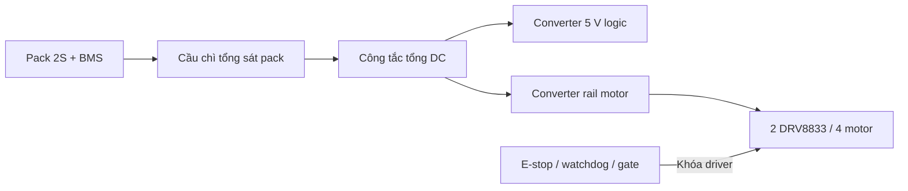

# Phương án nguồn cho bản TT 4WD

Cập nhật quyết định nguồn 02/11/2026; giữ ghi chú mua hàng 28/10/2026. Đây là cấu hình đề xuất để đối chiếu mẫu mua, chưa
phải BOM đã chọn hoặc thiết kế nguồn đã kiểm thử. Kiểm kê ở
[components.md](components.md); yêu cầu khóa driver ở
[hợp đồng an toàn](../firmware/shared/fpga-safety.md).

**Bổ sung07/11/2026:** E-stop phải cắt cấp VM và khóa driver nhưng giữ logic;
chủ dự án muốn vừa sạc vừa bật logic, có đo điện áp/cảnh báo pin yếu.
[Yêu cầu nguồn mới và tác động lên schematic](../docs/awcar-power-safety-requirements.md)
ưu tiên hơn các ví dụ mua sạc cũ bên dưới. Chưa chọn sạc/power-path hoặc
đầu vào adapter/USB-C; không mặc định sạc CC/CV thông thường đáp ứng tải
logic đồng thời. DSN.IN+ hiện vẫn cùng VM_MOTOR trong bản draft, cần tách.
Chủ dự án đã chọn adapter DC rời và yêu cầu chuyển sang pin không reset
logic. Mục tiêu adapter ban đầu12V3A/36W; bao tải và các điều kiện phải đo
ghi tại tài liệu trên, chưa coi khả năng dòng ra của DSN hoặc dòng sạc1A
là đã xác nhận từ cell/tải thực.

## Hướng ưu tiên hiện tại — 02/11/2026

Bốn motor TT là bản **9 V theo thông tin shop do chủ dự án cung cấp**;
chưa có mã/datasheet hoặc dòng kẹt đo thực. Chọn **pin Li-ion 2S1P + BMS 2S**,
nhánh motor qua cầu chì/đường dừng tới VM hai DRV8833 **trực tiếp**, mỗi motor
một cầu H. Không bắt buộc giữ motor đúng 9 V; không thêm buck motor ở bản đầu.
Pack 2S đầy 8,4 V với cell sạc 4,2 V, danh định 7,2–7,4 V. Nhánh logic/âm thanh
qua nguồn ổn áp 5 V riêng phù hợp từng board; không cấp pack vào GPIO.

Cần đo lực khởi động/rẽ ở pin yếu, dòng khởi động/kẹt, nhiệt driver và quá độ;
PWM không thay việc bảo vệ quá dòng. Sạc 2S 8,4 V CC/CV phù hợp pack, cầu chì
chọn theo tải/dây; mạch E-stop/gate giữ độc lập. Hai cell đủ hay không do phép
đo, không chỉ theo số lượng motor. **Chưa nghiệm thu nguồn hoặc xe thực.**

Các mục ví dụ motor 6 V, buck/buck-boost ở dưới là trao đổi có điều kiện trước
khi shop xác nhận 9 V; không dùng chúng làm cấu hình/BOM bắt buộc hiện tại.

## Cấu hình pin đề xuất

Ưu tiên bản đầu gọn và tiết kiệm: **1 pack Li-ion 18650 2S1P, hai cell xả
cao cùng mã/thông số, shop đóng pack hàn sẵn có BMS**. Mục tiêu tìm cell
khoảng 2500–3000 mAh, có datasheet dòng xả liên tục ít nhất 10 A/cell;
mục tiêu khả năng xả liên tục của cả pack/BMS là 10 A, phải xác nhận thực.
Đây là tiêu chí tìm mẫu dự phòng dòng, chưa phải dòng tải đã đo hoặc bảo
đảm phù hợp mọi motor TT. Không lấy dòng in riêng trên BMS thay khả năng
cell, mối nối, dây và đầu nối.

| Cấu hình | Tổng cell | Điện áp danh định/đầy với cell 3,6–3,7 V, sạc 4,2 V | Dung lượng nếu mỗi cell 2800 mAh | Vai trò |
| --- | --- | --- | --- | --- |
| 2S1P | 2 | 7,2–7,4 V / 8,4 V | 2800 mAh | Ưu tiên bản đầu |
| 2S2P | 4 | 7,2–7,4 V / 8,4 V | 5600 mAh | Tùy chọn thêm năng lượng, cần kiểm tra gá/khối lượng |

S là số cell/nhóm nối tiếp, P là số cell song song mỗi nhóm. Tăng P không
tăng điện áp; 2S1P không cộng đôi số mAh. Chưa tính thời gian chạy vì chưa
đo công suất trung bình của xe. Không cần chuyển 3S cho cấu hình hiện tại;
3S đầy 12,6 V còn vượt dải VM hoạt động 10,8 V của DRV8833.

Molicel P28A là ví dụ có datasheet công khai: 3,6 V, 2800 mAh, sạc 4,2 V;
không bắt buộc dùng đúng mẫu và không gán thông số này cho cell không rõ
mã. Cell mua phải đúng nguồn gốc/thông số, bộ bảo vệ và sạc phù hợp pack.

### Các cell Hshop trong ảnh đang đối chiếu

Ảnh có Sunpower 2500 mAh giá 45.000đ, Sunpower 2000 mAh giá 35.000đ và
Lishen 2000 mAh giá 46.000đ. Giá kiểm tra trên danh mục Hshop ngày
28/10/2026, chưa giao hàng/đóng pack/BMS. Hướng đề xuất theo chi phí và
dung lượng là **2 cell Sunpower 2500 mAh cùng mẫu**, 90.000đ tiền cell:
shop công bố xả liên tục khoảng 18 A, đỉnh trên 25 A; tên 10C/25 A không
được hiểu là 25 A liên tục. Chưa có datasheet hãng đúng mã hoặc đo thực,
chưa xác nhận chủ dự án chọn/mua. Đây là ứng viên đạt tiêu chí dòng theo
công bố shop, chưa phải xác nhận tải/nhiệt hoặc chất lượng cell thực.

Hai cell 2500 mAh tạo 2S1P danh định 7,4 V/2500 mAh, đầy 8,4 V; không
phải 5000 mAh. Nếu dùng bốn cell cùng mẫu tạo 2S2P thì 7,4 V/5000 mAh.
Không trộn ba loại khác nhau. Các cell rời trong ảnh chưa bao gồm BMS,
sạc hay pack lắp hoàn chỉnh; ưu tiên nhờ bên đóng pack phù hợp.

## Motor và dự toán dòng

Motor thực là TT vàng trục đôi, chưa rõ SKU/điện áp/dòng kẹt. Mẫu tham
chiếu Adafruit 3777 đo kẹt 1,2 A ở 4,5 V và 1,5 A ở 6 V; bốn mẫu như vậy
có thể cộng tới 6 A ở 6 V. Đây không phải phép đo motor AW-Car. Cần đo
khởi động, chạy có tải, rẽ skid-steer và tình huống kẹt có kiểm soát, kiểm
tra giới hạn dòng/nhiệt driver và thực hiện ngắt kẹt chủ động.

Dòng pin khác dòng motor do điện áp/hiệu suất converter:

`I_pack ≈ (V_motor × I_motor_total / η_motor + 5 V × I_logic / η_logic) / V_pack`

Ví dụ kiểm tra bao thiết kế: rail motor 5 V kéo 6 A và rail logic 5 V kéo
3 A, cả hai converter hiệu suất giả định 85%, pin dưới tải 6,4 V thì dòng
pack khoảng 8,3 A. Đây là giả định để sàng lọc, không phải tải liên tục đã
đo; chưa gồm xung quá độ và sai số hiệu suất. Nếu kết quả thực vượt giới
hạn, cần giảm tải/đổi pack/nguồn; không chỉ tăng cầu chì.

## BMS, sạc và rail nguồn

### Trường hợp xác nhận bốn motor 6 V: hạn chế sụt áp

Đây là phương án có điều kiện, không xác nhận motor đã có là bản 6 V và
không tự đổi lựa chọn pin 2S1P thành 2S2P. Hai DRV8833 nhận chung rail VM,
mỗi motor vẫn ở một cầu H riêng. Đấu nguồn các module theo nhánh song
song, không mắc motor nối tiếp, không nối chung đầu ra cầu H khác nhau.
Chung rail không tự giảm sụt áp: tổng dòng tăng khi bốn motor cùng tải.

Theo ví dụ TT 1,5 A kẹt ở 6 V, dự trù khoảng 6 A quá độ cho bốn motor;
cần đo đúng motor. Nếu giữ rail motor 6 V, đối chiếu converter có thể
chịu xung khoảng 6–8 A thực tại điện áp pin thấp nhất; dòng liên tục theo
tải/nhiệt thực, không coi toàn bộ dòng kẹt là chế độ vận hành bình thường.
Converter khỏe hơn không nâng định mức dòng/nhiệt từng cầu DRV8833.

Pin 2S xuống gần 6 V sẽ không đủ headroom cho nhiều buck đặt 6 V. Chọn
buck dropout thấp và dừng sớm theo headroom thực hoặc buck-boost đủ dòng
ở Vin thấp; chỉ thêm cell song song/tụ không khắc phục giới hạn này.
Ví dụ 6 V × 6 A motor + 5 V × 3 A logic, giả sử hiệu suất cả hai 85%,
pin 6,4 V dưới tải thì cần khoảng 9,4 A từ pack. Tiêu chí pack/BMS 10 A
khi đó sát biên giả định; phải kiểm tra xung, nhiệt và dự phòng thay vì
coi 10 A luôn đủ. Có thể hạ điện áp/tốc độ/giới hạn dòng để phù hợp bản đầu.

2S2P / 4 cell cùng mẫu giúp chia dòng mỗi cell và thường giảm sụt áp nội
pin so với 2S1P dùng cùng cell/điều kiện, đồng thời tăng dung lượng; không
tăng điện áp hoặc tự tăng khả năng BMS/dây/converter. 2S1P xả cao vẫn là
phương án tiết kiệm nếu tải thực cho phép. Không tăng số S để chữa sụt áp.

Đi dây nguồn ngắn, tiết diện/đầu nối đủ dòng, tránh để dòng motor đi qua
breadboard/Dupont/board MCU; rẽ nhánh logic và motor từ điểm phân phối
nguồn, đường hồi dòng motor không đi qua dây mass MCU. Bổ sung tụ bulk
và decoupling sát VM/GND từng driver theo thiết kế/tải/dây thực; chưa chốt
trị số tụ, không dùng tụ thay nguồn thiếu dòng. Khởi động bằng ramp duty
và giới hạn dòng khi cần, chưa triển khai firmware/RTL mới. Heartbeat và
E-stop vẫn hoạt động trong quá trình khởi động/ramp.

Đo điện áp đồng thời ở đầu ra pack, vào/ra converter và VM driver khi cả
bốn motor cùng khởi động/rẽ để định vị sụt áp; đánh giá cả rail logic.
Độ dốc ramp/quãng dừng/ngưỡng pin yếu và trị số cầu chì chờ đo thực.

### Mục tiêu linh kiện cho phương án ban đầu

| Hạng mục | Đề xuất đối chiếu | Điều kiện còn thiếu |
| --- | --- | --- |
| BMS | Li-ion **2S**, mục tiêu xả liên tục thực 10 A, có bảo vệ quá sạc/quá xả/quá dòng/ngắn mạch và cân bằng | Ngưỡng bảo vệ, dòng đỉnh/thời gian trễ, nhiệt, dòng sạc, sơ đồ cổng chung/riêng; nếu pack tích hợp đúng BMS thì không mua trùng |
| Sạc | **Bộ sạc Li-ion 2S 8,4 V CC/CV, 1 A**, mua nguyên bộ để đơn giản | Dòng sạc phải được cell/pack/BMS cho phép, đúng cực/đầu nối; chưa chọn mẫu, không dùng adapter DC thông thường hoặc TP4056 một cell |
| Rail logic | Converter **5 V, mục tiêu 3 A liên tục thực** cho hai ESP32, FPGA, ampli và phần phụ phù hợp | Dự toán/đo tải thật, nhiệt, ripple, sụt áp; 3,3 V cảm biến qua rail phù hợp, không đưa 5 V vào GPIO |
| Rail motor | **2S → cầu chì/đường dừng → VM DRV8833 trực tiếp**, mỗi motor một cầu H | Motor 9 V theo shop; đo lực/rẽ pin yếu, dòng kẹt, nhiệt và quá độ; không mặc định mua buck motor |

BMS không thay sạc CC/CV; sạc không thay BMS. Dùng cổng sạc theo sơ đồ BMS,
không đấu bỏ qua bảo vệ. Bản đầu tắt tải khi sạc; vừa sạc vừa chạy cần thiết
kế power-path riêng, chưa nằm trong cấu hình này. Nếu muốn sạc USB-C, chọn
module sạc Li-ion 2S thực có nâng áp/điều khiển sạc phù hợp; tên USB-C
không tự xác nhận hỗ trợ 2S. Không cần mua IC BQ24133 rời chỉ để theo tài liệu.

Không đưa 8,4 V thẳng vào chân 5 V/3V3 MCU hoặc motor chưa rõ định mức.
Converter phải duy trì rail khi pin yếu dưới tải; buck thiếu headroom thì
chọn loại dropout thấp/buck-boost hoặc nâng ngưỡng dừng pin yếu. Chưa chốt
ngưỡng cắt pin mềm; không chờ BMS cắt sâu mới dừng xe. Motor tái sinh/phanh,
nhiễu và ngắt nguồn cần kiểm tra khả năng hấp thụ năng lượng/tụ/lọc của
rail motor, không giả định buck thường nhận được dòng ngược.

## Cầu chì và đường cấp nguồn

Mua đối chiếu **đế cầu chì lá mini ô tô mắc nối tiếp, định mức DC 32 V**,
có dây/đầu nối được công bố chịu dòng phù hợp. Cầu chì đặt trên cực dương
đầu ra pack được bảo vệ, sát pack trước đoạn dây dài/công tắc/chia nhánh.
Đây là sơ đồ khối; cổng sạc và BMS tuân theo sơ đồ mẫu thực.

**Chưa chốt viên cầu chì bao nhiêu A**: cần dòng pack bình thường và lúc
khởi động, thời gian xung/I²t, đường cong thời gian–dòng, khả năng cắt DC,
định mức dây/đầu nối và nhiệt độ. BMS ghi 10 A không đồng nghĩa lắp cầu
chì 10 A. Chọn viên bảo vệ được dây/đầu nối yếu nhất, chịu được khởi động
hợp lệ và cắt lỗi trước khi dây hư; nhánh dây nhỏ có thể cần bảo vệ riêng.
Không thay bằng viên lớn hơn chỉ vì đứt khi thử.

Cầu chì chủ yếu bảo vệ lỗi dòng/đường dây, không thay giám sát kẹt motor
hay E-stop. Gate phải khóa độc lập MCU/clock FPGA; nhả E-stop/heartbeat
trở lại không tự ARM. Relay thường 5 V chưa phải watchdog và chưa là món
bắt buộc; nếu dùng để cắt công suất cần chọn khả năng đóng/ngắt tải DC
cảm và dòng khởi động thực.

## Nguồn tham chiếu

- [Molicel P28A: datasheet cell](https://www.molicel.com/wp-content/uploads/INR18650P28A_1.3_Product-Data-Sheet-of-INR-18650-P28A-80093.pdf).
- [Hshop: Sunpower 2500 mAh, xả liên tục khoảng 18 A do shop công bố](https://hshop.vn/pin-sac-18650-li-ion-rechargeable-battery-3-7v-2500mah-10c-sunpower).
- [Hshop: danh mục pin và giá ba mẫu](https://hshop.vn/nguon-dien-pin-sac).
- [Adafruit 3777: ví dụ TT và dòng đo](https://www.adafruit.com/product/3777).
- [TI DRV8833: dải nguồn/driver](https://www.ti.com/product/DRV8833).
- [TI DRV8833 datasheet: nguồn, bulk capacitance và bố trí đường dòng](https://www.ti.com/lit/ds/symlink/drv8833.pdf).
- [XLSEMI XL4016: dải điện áp đầu vào](https://www.xlsemi.com/datasheet/XL4016-EN.pdf): ví dụ kiểm tra headroom/Vin, chưa phải IC/module được chọn.
- [Pololu: buck-boost khi Vin cao/bằng/thấp hơn Vout](https://www.pololu.com/category/133/step-up-step-down-voltage-regulators): nguyên lý, không yêu cầu mua các module dòng nhỏ trong trang này cho motor.
- [TI BQ24133: nguyên lý sạc chọn số cell, 4,2 V/cell](https://www.ti.com/product/BQ24133).
- [Littelfuse: Fuseology, dòng khởi động và dây dẫn](https://www.littelfuse.com/assetdocs/littelfuse-fuseology?assetguid=c81c1a21-b903-44b6-b46d-180c48f7c3c5).

Chưa chọn SKU/giá hoặc mua pin/BMS/sạc/converter/cầu chì. Chưa đo tải,
nhiệt, quãng dừng hoặc chạy xe; kiểm tra tài liệu không chứng minh nguồn
và các bảo vệ hoạt động trên phần cứng.
